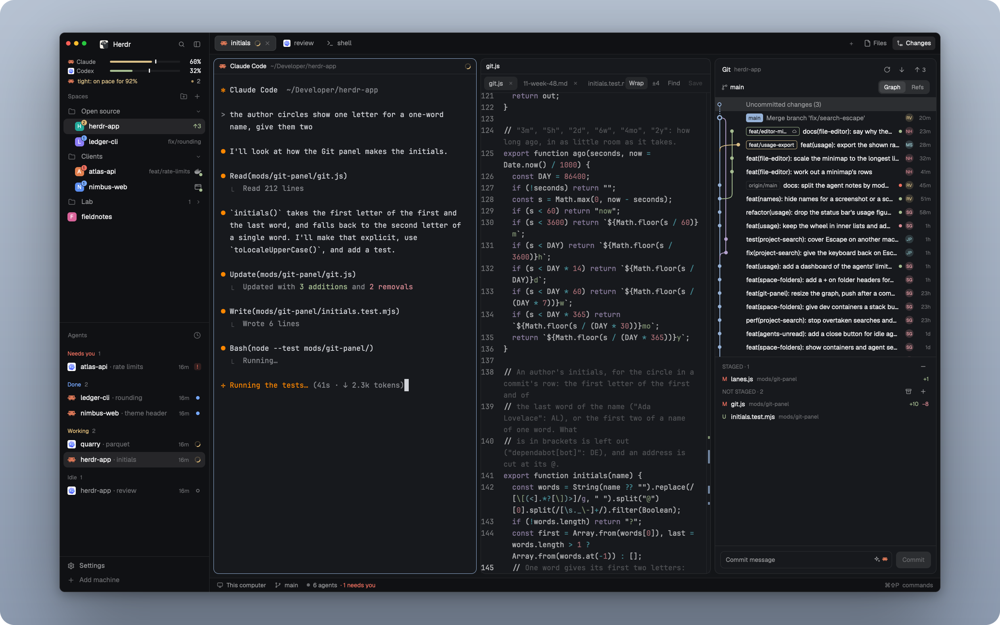
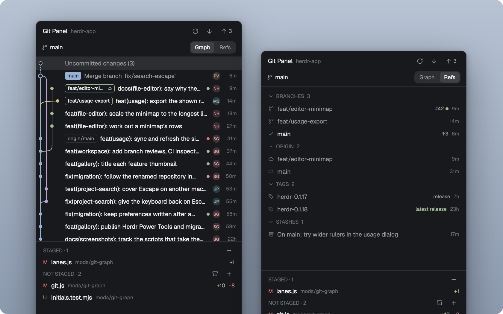
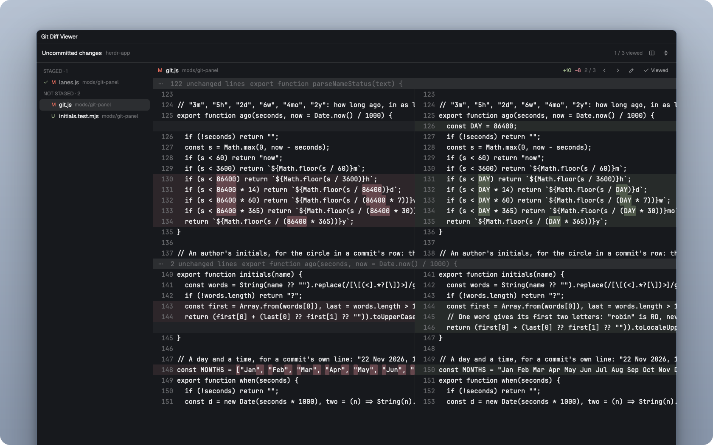
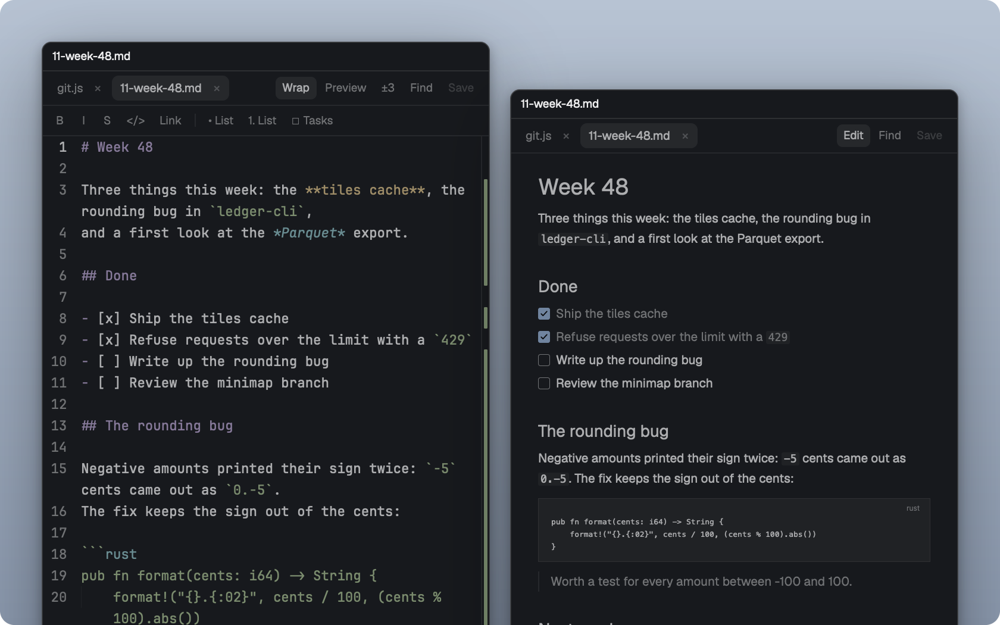
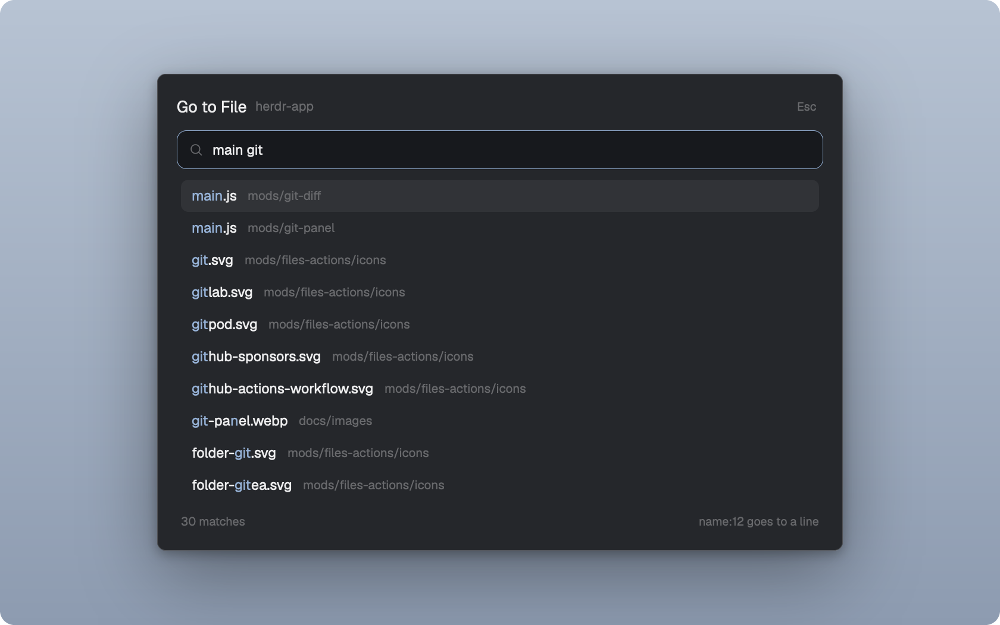
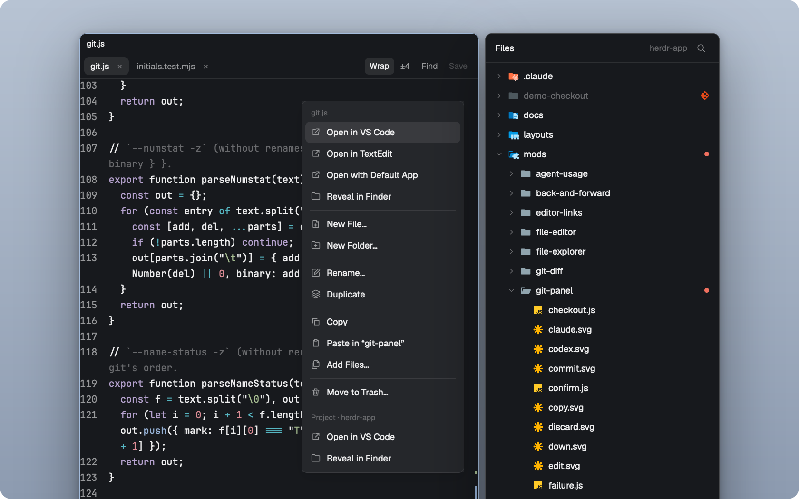

# Herdr App Configuration

[Herdr](https://herdr.dev) is a desktop app for terminals and coding agents. This is my setup of it: ten additions for watching the agents' limits, keeping their spaces in folders, and reading, searching, editing and committing code without leaving the window.

It is opinionated: everything here follows my own preferences and the way I work. Take all of it or a single mod, fork it, or use it as inspiration.



*Every picture here is the real app, run in a sandbox: the projects, sessions and figures are made up.*

## What's here

Each feature has a page with everything it does: every key, limit and edge case.

| Feature | In short | Mods |
|---|---|---|
| [Usage](docs/usage.md) | Whether the agents' limits last the week, and where the usage went | `usage` |
| [Space folders](docs/space-folders.md) | Folders for the Spaces sidebar, with each space's containers and agents | `space-folders` |
| [Unread agents](docs/unread-agents.md) | "Mark as unread" for the Agents list | `agents-unread` |
| [Git panel](docs/git-panel.md) | The history as a graph, and everyday git by click | `git-panel` |
| [Git diff](docs/git-diff.md) | A diff pane, side by side, with the changed words marked | `git-diff` |
| [File editor](docs/file-editor.md) | A text editor in a pane, also from a path Cmd-clicked in a terminal | `file-editor`, `editor-links` |
| [Project search](docs/project-search.md) | Search and replace in every file of the project | `project-search` |
| [Go to file](docs/go-to-file.md) | Any file of the project, by some of its name | `go-to-file` |
| [File actions](docs/file-actions.md) | The Files panel with icons, a right-click menu, drag to move and undo | `files-actions` |
| [Hide names](docs/hide-names.md) | Made-up names around the content, for a screenshot or a screen share | `tabs-names`, `pane-names`, `status-names` |

Also here: `layouts/main-folders.json`, Herdr's default layout showing all of the above, with the panes you're not in faded and the dividers lit on hover; `keys.json` and `settings.json`, my key bindings and settings; notes for coding agents working in this folder (`AGENTS.override.md`, `CLAUDE.md`, `docs/agents/`); and the scripts that take the pictures on this page ([`docs/screenshots/`](docs/screenshots/README.md)).

## The tour

### Usage

**Will the weekly limit last?** One sentence says so for the limit most at risk, Claude's or Codex's, and a ruler for each limit shows which project is spending it.


- **The week as a chart:** what was used against an even pace, and where this pace ends.
- **Burning now:** the projects that used an agent in the last hour, and how fast.
- **Where it went:** tokens and cost by project, model, session and machine, and the year as a calendar.

<kbd>Cmd</kbd>+<kbd>Shift</kbd>+<kbd>U</kbd> opens it, and a widget above Spaces keeps the limits in view. [Everything about usage](docs/usage.md)

### Space folders

**Folders for the Spaces sidebar.** Drag a space onto a folder, fold a folder to its count, and the next space opened on a filed project lands in the same folder.


- **Agents on the avatar:** a number counts a space's agents, in the color of the most urgent one.
- **Containers on the row:** a button starts and stops the project's DDEV or Docker Compose containers.
- **The order is real:** `space.next` and `space.prev` follow what is drawn.

[Everything about space folders](docs/space-folders.md)

### Unread agents

**Mark an agent as unread.** Click the ring on an idle agent's row and it goes back under Done, until you come back to it or it starts working again.


<kbd>Cmd</kbd>+<kbd>Alt</kbd>+<kbd>1</kbd> to <kbd>9</kbd> jump to the first nine agents, in the order drawn. [Everything about unread agents](docs/unread-agents.md)

### Git panel

**The repository you are in, as a graph.** Every branch as lines of commits with what is not committed on top, and a second view of branches, remotes, tags and stashes.



- **Everyday git, by click:** stage, commit, fetch, pull, push, switch, branch, tag and stash.
- **A message written for you:** ask Claude or Codex for the commit message, then edit it.
- **GitHub at a glance:** with [`gh`](https://cli.github.com), a branch shows its pull request and a commit its checks.
- **Nothing drastic:** it never rebases, merges, resets or forces. Those stay in a terminal.

[Everything about the Git panel](docs/git-panel.md)

### Git diff

**Read a change, file by file.** Click a file in the Git panel and its diff opens in a pane: side by side when it fits, with the changed words marked and the unchanged lines folded away.



<kbd>J</kbd> and <kbd>K</kbd> walk the files, <kbd>V</kbd> ticks one as viewed and moves on, <kbd>S</kbd> switches between side by side and one column. It only reads. [Everything about the diff pane](docs/git-diff.md)

### File editor

**An editor beside the terminals.** Click a file and it opens in a pane, each file a tab. <kbd>Cmd</kbd>+<kbd>S</kbd> saves, nothing is saved by itself, and unsaved text survives a restart.



- **From a terminal:** Cmd-click `src/app.ts:42:7` and it opens at that line and column.
- **Markdown:** shortcuts, a toolbar and a rendered preview.
- **Since the last commit:** a strip beside the text marks the lines added, changed and deleted.
- **The usual tools:** find and replace, several cursors, line and comment commands.

[Everything about the file editor](docs/file-editor.md)

### Project search

**Search and replace across the project.** <kbd>Cmd</kbd>+<kbd>Shift</kbd>+<kbd>F</kbd> searches every file as you type, with [ripgrep](https://github.com/BurntSushi/ripgrep). Open the replace row and every match shows what it becomes.


- **Narrow it:** match case, whole words, regular expressions, files to include and exclude.
- **Replace** one match, a file or all of them, and undo the last replace.
- **Walk the results** from anywhere with <kbd>F4</kbd> and <kbd>Shift</kbd>+<kbd>F4</kbd>.

[Everything about project search](docs/project-search.md)

### Go to file

**Any file, a few letters away.** <kbd>Cmd</kbd>+<kbd>O</kbd>, then some of the name: words in any order, `gp main` finds `git-panel/main.js`, and `:12` goes to a line. With nothing typed, the files opened lately come first.



[Everything about go to file](docs/go-to-file.md)

### File actions

**The Files panel, as a file manager.** Right-click for new, rename, duplicate, copy, paste and Trash, drag to move, and <kbd>Cmd</kbd>+<kbd>Z</kbd> takes back the last move, rename or Trash.



- **At a glance:** each type's icon, a dot on folders with changes inside, and the file in the editor highlighted.
- **To a terminal:** drag a file onto a terminal to paste its path, a quick way to hand it to an agent.
- **In and out:** drop files in from Finder, or open one in VS Code, Obsidian or Finder.

[Everything about file actions](docs/file-actions.md)

### Hide names

**A screenshot without your project names.** <kbd>Cmd</kbd>+<kbd>Shift</kbd>+<kbd>H</kbd> gives every space, folder, tab, branch and machine around the content a plausible made-up name, the same one every time. What the panes show stays real: that is the content you chose to show.


[Everything about hide names](docs/hide-names.md)

## The same everywhere

Three things hold for every feature, so the pages don't repeat them:

- **Other machines.** A space on another machine works the same way: files, search, git and the editor run there through Herdr, with nothing installed. What needs this Mac (opening in an app, Finder, the clipboard, the Trash) is offered only for files here.
- **Nothing is overwritten or lost quietly.** A file operation onto a name that exists is refused, a save over a change made elsewhere asks first, discarded git changes become a stash, and the Git panel checks that what it showed is still true before it changes anything.
- **Quiet in the background.** The panels read while they are on screen and Herdr is the active app, and catch up when you come back.

## Keys

All in `keys.json`. A feature's page says what each key does; this is what to copy into a `keys.json` of your own.

| For | Copy |
|---|---|
| Undo in the Files panel | `"cmd-z": "files-actions.undo"` in `global` |
| The editor | the sections `mod:file-editor` and `mod:file-editor > Input` |
| Project search | the sections `mod:project-search` and `mod:project-search > Input`, and `cmd-shift-f`, `f4`, `shift-f4` from `global` |
| Go to file | the section `mod:go-to-file > Input`, and `cmd-o` from `global` |
| Hide names | `cmd-shift-h` from `global` |
| Usage | `cmd-shift-u` from `global` |
| Jumping to an agent | `cmd-alt-1` to `cmd-alt-9` from `global` |

Commands without a key (folders, the Git panel's, the diff's, more of the editor's) are in the command palette, Cmd+Shift+P, and listed on each page.

## Install

The quick way: point your AI agent at this README and ask it to install the mods in your Herdr, all of them or only the ones you name. Everything it needs is on this page: the commands below, what each mod needs, and the [keys](#keys) to copy.

By hand: this was built against Herdr 0.1.18. From a clone of this repository, the following adds the mods and the layout that shows them:

```sh
cp layouts/main-folders.json ~/.config/herdr-app/layouts/
for m in space-folders agents-unread files-actions file-editor editor-links project-search go-to-file git-panel git-diff usage tabs-names pane-names status-names; do
  cp -R "mods/$m" ~/.config/herdr-app/mods/ && herdr-app check ~/.config/herdr-app/mods/"$m"
done
herdr-app do layout.switch '{"name":"main-folders"}'
```

Your own layout stays as it was: `layout.switch` goes back to it, and deleting the copied files removes all of this. Then copy the [keys](#keys) you want.

What needs what:

- Copy each mod's folder whole, `mod.json` included: a mod folder Herdr first sees without one is docked into the shown layout by itself.
- `files-actions`, `project-search`, `go-to-file`, `editor-links` and `git-panel` open files in `file-editor`. `git-panel` needs `git-diff`, which is what a click on a file opens.
- `project-search` and `go-to-file` need [ripgrep](https://github.com/BurntSushi/ripgrep) (`brew install ripgrep`), also on another machine whose project is searched. `usage` needs `node`. The Git panel's GitHub marks need [`gh`](https://cli.github.com), and its message writer `claude` or `codex`.
- `editor-links` is turned on by the layout's `"link_handlers": ["editor-links"]` (Herdr adds it to a layout of your own the first time it sees the mod).
- `go-to-file` and the `usage` dialog are in no layout: their keys open them.
- The three hide names mods, `space-folders`, `agents-unread` and `usage` share the mode: with only some of them, only those hide their names. `status-names` holds the command that switches it.

For only one of them, copy and check its folder, then point a layout of your own at it: `{ "mod": "space-folders" }` in the `spaces` block, `{ "mod": "agents-unread" }` in the `agents` block, `{ "mod": "files-actions" }` in the `files` block, `{ "mod": "git-panel" }` in the `changes` block, or a block 62 px tall with `{ "mod": "usage", "props": { "role": "side" } }` for the usage widget. `project-search` needs two blocks, as in `main-folders.json`: the panel, and a block that is always shown (it can be 0 px tall) with props `{ "keys": true, "show": { ... } }`, which takes Cmd+Shift+F while the panel is hidden and shows it. Herdr's shipped layouts are read-only, so clone one first:

```sh
herdr-app do layout.clone '{"name":"main","as":"my-layout"}'
```

The layout and the cloned mods are copies of Herdr's `main`, `spaces`, `agents`, `files`, `tabs`, `pane` and `workspace-status`, so they don't pick up changes Herdr makes to those later.

## How the repository works

This repository is the app's home folder, `~/.config/herdr-app`, with only the customized files tracked. Herdr's own mods and layouts sit next to the custom ones and are replaced on every start, and its state files change constantly. So `.gitignore` is an allowlist: everything in the folder is ignored unless it is listed there, and a new mod, layout or theme needs one line.

## License

Apache-2.0, see [LICENSE](LICENSE). `mods/space-folders/main.js`, `mods/agents-unread/main.js`, `mods/files-actions/main.js`, `mods/tabs-names/main.js`, `mods/pane-names/main.js`, `mods/status-names/main.js` and `layouts/main-folders.json` are modified copies of files from Herdr, which is also Apache-2.0. The icons in `mods/files-actions/icons/` are Material Icon Theme's, which is MIT. See [NOTICE](NOTICE).
