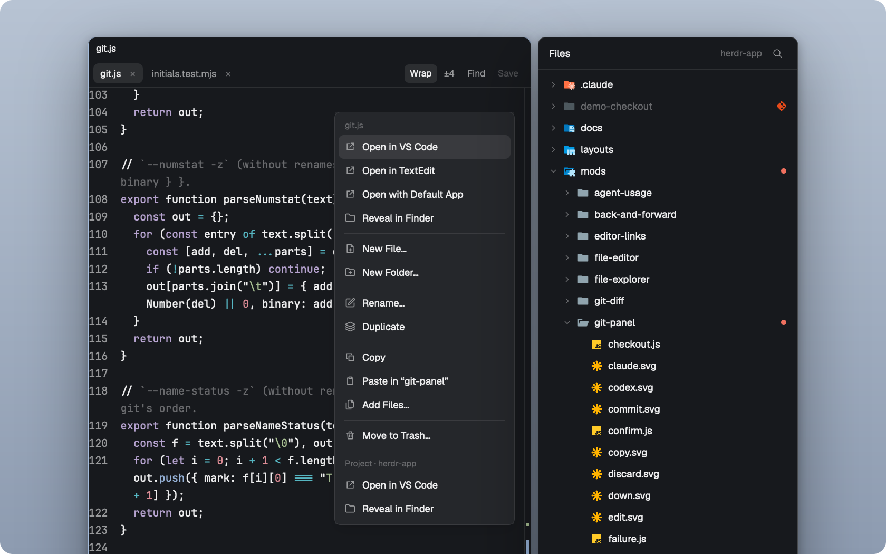

# File actions

The Files panel, with more to look at and more to do. A click on a file opens it in the [file editor](file-editor.md).

*The Files panel, with a file's right-click menu. The names in the pictures are made up.*

- **Icons:** every file and folder has its type's icon, from [Material Icon Theme](https://github.com/material-extensions/vscode-material-icon-theme); a folder's changes when it opens. What git ignores is faded.
- **The file in the editor:** the file the tab's editor shows is highlighted in the tree. When it is inside a closed folder, that folder is highlighted instead.
- **Changes in folders:** a folder with modified, added or removed files anywhere inside it shows a dot, so a change is seen without opening the folder. The dot is green when everything inside is new, red when everything is removed or something is in conflict, and otherwise the color of a modified file.
- **Open elsewhere:** right-click a file or a folder to open it in VS Code or Obsidian, and a file in TextEdit. A file opens in VS Code inside its repo's window. Obsidian is offered for Markdown, canvas and base files anywhere, and for anything inside one of its vaults: it opens a folder only as a vault. Reveal in Finder shows it in its folder.
- **Open the project:** the same menu ends with the project, and right-clicking the header or the room under the list shows the project and what the folder shown takes: a new file, a new folder, a paste.
- **New file or folder:** right-click, New File or New Folder, and name it. It is made in the folder you clicked, next to the file you clicked, or in the top folder when you clicked the header or the room under the list. A new file opens in the editor.
- **Rename:** right-click, Rename. The name is selected without its extension.
- **Duplicate:** right-click, Duplicate. The copy is named as Finder names it: `notes copy.md`, then `notes copy 2.md`.
- **Delete:** right-click, Move to Trash. It asks first, and the file can be put back from the Trash.
- **Move:** drag a file or a folder onto a folder to put it in, onto a file to put it next to that file, or under the list for the top folder. Its name follows the pointer while you drag, and a toast says where it went.
- **To a terminal:** drag a file or a folder onto a terminal to paste its path there, quoted and without Enter: a quick way to hand a file to an agent. Nothing is moved.
- **Undo:** Cmd+Z takes back the last move, rename or Trash, once, and a toast says what it did. A trashed file comes back out of the Trash. It is for slips: it works for five minutes, while the panel still shows the same folder. After a duplicate, a copy or a new file or folder there is nothing to take back.
- **From Finder:** drop files or folders from Finder onto a folder, onto a file for that file's folder, or under the list for the top folder. They are copied: the originals stay where they are.
- **Add Files…:** right-click, Add Files…, and pick them in the system's file picker. They are copied in the same way.
- **Search:** the lens in the header goes to the [search panel](project-search.md), and right-clicking a folder offers Find in Folder.
- **To and from the clipboard:** right-click, Copy puts a file or a folder on the clipboard, for Cmd+V in Finder; Paste copies in what was copied in Finder, or here. Dragging out to Finder is not possible: Herdr's file drag stays inside its window.

Nothing is ever overwritten: a new file or folder, a rename, a move, a copy or a paste onto a name that exists is refused.

The panel notices changes on disk as they happen, and waits while Herdr is in the background: it catches up when you come back. In a big repository it reads git less often after a slow read.

Opening in an app, Finder, the clipboard, Add Files… and the Trash are for files on this Mac. For a folder on another machine the menu offers New File, New Folder, Rename and Duplicate, drag still moves, and undo takes back a move or a rename.

Undo is the command `files-actions.undo`, bound in `keys.json` under `global` so that it works while the keyboard is in a terminal, which is where it is after a drag. It works while the Files panel is shown. Two things follow from binding it there: terminal programs no longer receive Cmd+Z, and a Cmd+Z pressed by habit within those five minutes takes back the last file action. Text fields, such as the rename dialog, keep their own undo.

---

[Back to the README](../README.md)
