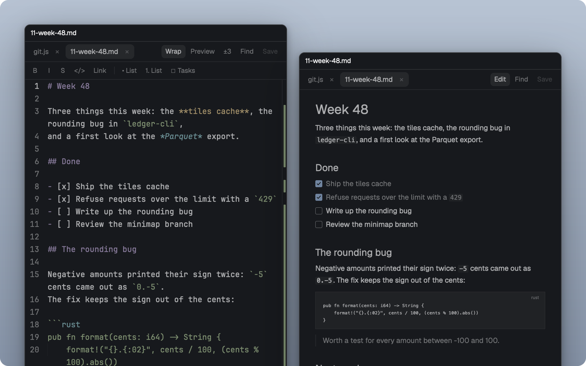

# File editor

A text editor beside the terminals. Click a file in the Files panel and it opens in a pane of the tab, split in next to the focused pane; the next file opens in the same pane, as another tab in its strip. The Files panel stays where it is, and can show Changes meanwhile.

*A Markdown file in the editor, and its preview. The names in the pictures are made up.*

- **Wrapped lines:** long lines wrap, and go on under the line's own indentation. The Wrap button, or the command palette's "Editor: Toggle Line Wrap", turns that off for a file, and long lines then scroll sideways. The choice is kept with the file.
- **Indentation:** Tab indents as the file does: with tabs in a Makefile or a file indented with tabs, else by the file's own step of 2, 4 or 8 spaces.
- **Save:** Cmd+S. Nothing is saved by itself. A dot on a file's tab means unsaved text, and closing that tab asks first.
- **Changes made elsewhere:** a file an agent or git changes is shown as it now is, when nothing is unsaved here. When something is, a save is refused and the editor asks which text to keep.
- **Nothing typed is lost:** the open files and their unsaved text are kept as you type. Close the pane or restart Herdr, open a file in that tab again, and they are back.
- **Find and replace:** Cmd+F and Cmd+Alt+F, with match case and regular expressions. Enter and Shift+Enter, or Cmd+G and Cmd+Shift+G, go through the matches; Replace all is one undo. The bar shows the line of the current match, because the text shows a selection only while it has the keyboard: click that line, or press Cmd+Enter, to go to it with the keyboard in the text.
- **Several cursors:** Alt+click adds one, Alt+Shift+drag selects a block, Cmd+Alt+Up or Down adds one above or below. Escape goes back to one.
- **Lines:** Alt+Up and Alt+Down move the selected lines, Cmd+Shift+D duplicates them, Cmd+/ comments them out or back in.
- **Wrap a selection:** with text selected, typing `"` `'` `` ` `` `(` `[` `{` `<` or `~` puts the selection inside the pair instead of replacing it, and keeps it selected. In Markdown `*` and `_` do too, so typing `*` twice makes bold.
- **Same word:** Cmd+D selects the word under the cursor, then jumps to the next place it is found. It moves one selection: it does not add cursors.
- **Markdown:** Cmd+B bold, Cmd+I italic, Cmd+E code, Cmd+Shift+X strikethrough, Cmd+K link, Cmd+Shift+8 bullets, Cmd+Shift+7 numbers, Cmd+Shift+9 tasks (again ticks them). Enter in a list goes on with it, and ends it on an empty item; in a numbered list the items under the new one are counted on. The same as buttons above the text.
- **Preview:** Cmd+Shift+V, or the Preview button, shows a Markdown file rendered, with any HTML in it shown as text. Find works there too: every match is highlighted, the current one in yellow, and "Go to line" goes to it in the text. Select something in the preview and switch back: the text opens with it selected.
- **Changes since the last commit:** a file git has gets a thin strip on the right of its text, with a mark where lines were added (green), changed (blue) or deleted (red), unsaved typing included. The strip is the whole file from top to bottom, not a margin: in a file shorter than the pane a mark is level with its lines, until a long line wraps above them, and in a longer file it shows where in the file they are. Click a mark, or press Alt+F3 and Alt+Shift+F3, or the `±` button that counts the changes, to go to a change with its lines selected. A file git does not have yet has no marks.

- **From a terminal:** Cmd-click a file path in a terminal, an agent's `src/app.ts:42:7` for one, and it opens in that tab's editor at that line and column (`editor-links`). Paths on another machine open there. Images, PDFs, archives, folders and missing files go to Herdr's usual opener instead. Herdr only sees a path as a link when it has a folder in it (`src/app.ts`, `./app.ts`, `~/x/app.ts`): a bare `app.ts:42` is not underlined and can't be clicked.
- **Tabs:** the mouse's back and forward buttons go to the previous and the next file of the strip.
- **The pane's name:** the pane's header says which file the editor shows, and "File Editor" when it shows none (the diff pane's says "Git Diff Viewer"). A name you give the pane yourself stays.
- **Text size:** the text is as large as the terminals' (`font_size`), as Herdr's own file preview and diff are.

Undo, redo, indenting, bracket pairs and folding are Herdr's own editor. Files too large to edit open read-only.

A file on another machine is edited the same way. It is saved by a short shell script that Herdr runs there, sent along with every save: nothing is installed on that machine, which only needs `sh`. The file keeps its permissions, and a save is refused when the file changed there meanwhile.

The keys are in `keys.json` under `mod:file-editor`, so they count only while the keyboard is in the editor. Cmd+F is also under `mod:file-editor > Input`: Herdr's editor keeps that key for itself, and the editor binds that section's keys itself, deeper than Herdr's, while the keyboard is in the text. (Since Herdr 0.1.17 a section named that way binds nothing on its own; the editor, the search panel and Go to file read theirs from `keys.json` and install them.) There, Cmd+B, Cmd+D, Cmd+Shift+D and Cmd+/ do the above instead of what they do elsewhere (the sidebar, splitting a pane, help), and Cmd+Z undoes text instead of the last file action. `file-editor.wrap` is not bound; it and the preview are in the command palette.

---

[Back to the README](../README.md)
