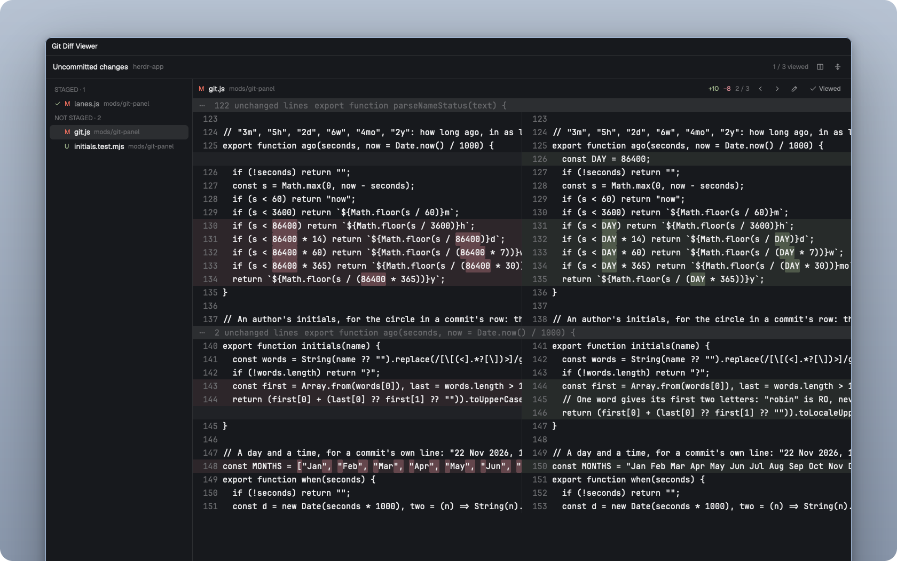

# Git diff

A pane beside the terminals for reading a change, opened by clicking a file in the [Git panel](git-panel.md): of what is not committed, of a commit, or of a stash. One a tab; the next file clicked shows in the same pane.

*An uncommitted change side by side, with the changed words marked and one file ticked as viewed. The names in the pictures are made up.*

- **Side by side** when the pane is wide and the longest line fits in half of it, else one column with the old and the new line numbers. `S`, or the button in the header, switches.
- **The words that changed** inside a changed line are colored stronger than the line.
- **Unchanged lines** are left out, three around each change, with a row that says how many were skipped. Click that row, press `W`, or use the header's button for the whole file.
- **Files:** listed on the left, in two groups for uncommitted changes (staged, not staged). `J` and `K`, the arrows, or the mouse's forward and back buttons go to the next and the previous one.
- **Viewed:** `V`, or the Viewed button, ticks the file and goes to the next one not viewed. The header counts them. A tick on an uncommitted file goes away when the file changes again.
- **To the editor:** `O`, or the pencil, opens the file as it is now in the [editor](file-editor.md), at the first changed line for an uncommitted file.

Uncommitted changes are read again as files change, less often after a slow read, and not while Herdr is in the background. The pane only reads: it changes nothing in the repository. The keys count while the pane has the keyboard. A diff is cut at 6,000 lines, and it is not syntax-colored.

Six commands can be bound in `keys.json`: `git-diff.next`, `git-diff.prev`, `git-diff.viewed`, `git-diff.mode`, `git-diff.whole` and `git-diff.edit`.

---

[Back to the README](../README.md)
