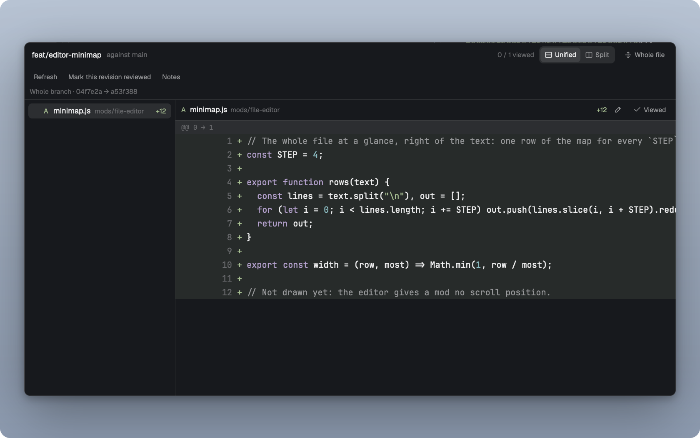

# Git Diff

A pane beside the terminals for reading a change, opened by clicking a file in the [Git panel](git-panel.md): of what is not committed, of a commit, of a stash, or of a branch comparison. One a tab; the next file clicked shows in the same pane.

*An uncommitted change side by side, with the changed words marked and one file ticked as viewed. The names in the pictures are made up.*

- **Unified and Split.** Use the header or press `S` to switch. Auto uses Split when both columns fit and Unified for new or deleted files. Unified shows both line numbers and scrolls horizontally.
- **Code and word highlights.** Added lines have a green background and removed lines have a red one. The exact words changed get a stronger tint. Syntax colors identify keywords, strings, comments and numbers in common code formats.
- **Hunks and context.** Each hunk shows its starting line numbers and function name when Git provides one. Click a gap to show its unchanged lines in groups of up to 80. Click **Hide** to collapse that gap. Press `W` or click **Whole file** to see the whole diff with context.
- **Files.** The list shows additions and deletions per file and groups uncommitted changes into staged and unstaged. Click the filename in a narrow pane or press `F` to search the changed files. `J` and `K`, the arrows, and the mouse's forward and back buttons move between files.
- **Stage or unstage a hunk.** In the uncommitted changes view, click **Stage hunk** or **Unstage hunk** in its header. Git updates the index and keeps your working file as it is. Return to the changes view to stage individual hunks after looking at the whole file. Use the Git panel to stage an untracked or binary file.
- **Viewed:** `V`, or the Viewed button, ticks the file and goes to the next one not viewed. The header counts them. A tick on an uncommitted file goes away when the file changes again.
- **To the editor:** `O`, or the pencil, opens the file as it is now in the [editor](file-editor.md), at the first changed line for an uncommitted file.

Uncommitted changes refresh as files change while Herdr is active, less often after a slow read. Commit, stash and branch comparisons are read-only. The shortcuts work while the pane has the keyboard. The diff displays up to 6,000 patch lines.

## Review a branch

In the Git panel’s Refs view, right-click the branch you want to read, choose **Review branch…**, then choose a base branch. Type to filter, use the arrow keys to highlight a match, and press Enter. The repository header’s menu offers the same action for the current branch. The viewer shows the committed changes from the common ancestor to the reviewed tip. The two short commit IDs identify the exact comparison. **Refresh** reads both branch tips again, using refs available on the repository’s machine.

- **Mark this revision reviewed** remembers the displayed tip. Opening the branch again, or refreshing it after more commits, shows the follow-up changes. **Show whole branch** and **Since my last review** switch between the two ranges. If the original tip is outside the new history or the common ancestor moved, the viewer explains why it opened the whole branch.
- **Viewed** applies to the file’s content and mode on both sides. Files whose diff stays identical keep their ticks. Reading a follow-up for a file you previously marked viewed brings its whole-branch tick up to date. A file you skipped initially still needs its original changes reviewed.
- Click an added or removed line to write feedback. A split row with changes on both sides lets you choose the side. **Save note** keeps its path, original revision, side, line, excerpt and feedback. **Notes** lists these drafts for this checkout, branch and base, including after a restart. A note follows its line only when its context matches one changed line. Ambiguous or missing lines are marked outdated.
- In **Notes**, tick the feedback to include and choose **Copy review notes**. The copy names the branch, the base and the pinned tip. Outdated or unverified notes stay in the list. **Remove** deletes a saved note.

You can bind `git-diff.next`, `git-diff.prev`, `git-diff.viewed`, `git-diff.mode`, `git-diff.whole`, `git-diff.edit` and `git-diff.files` in `keys.json`. Use `git-diff.unified`, `git-diff.split` or `git-diff.auto` to choose a layout directly.

---

[Back to the README](../README.md)
