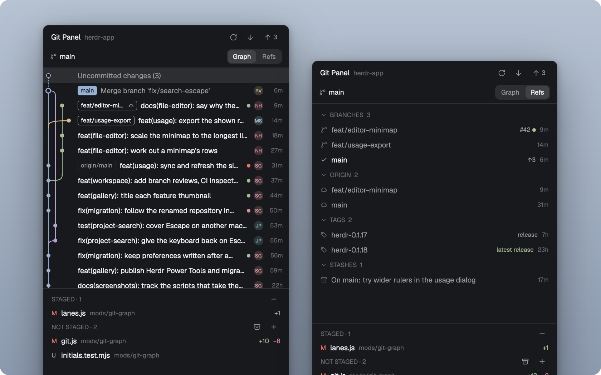
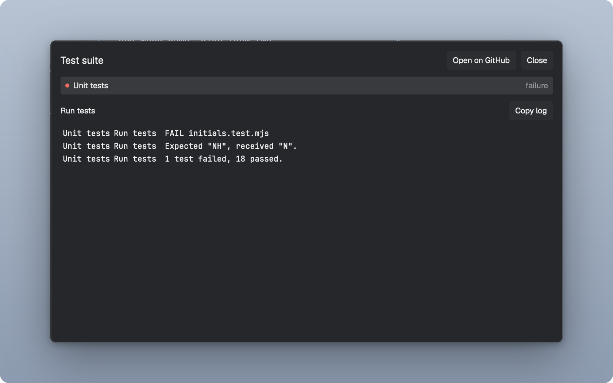

# Git Graph

The repository the focused pane is in, in the panel on the right, in place of Herdr's Changes: the tab bar's Changes button opens it. It follows the pane you are in, on this Mac or another machine.

*The graph with what is not committed, and the Refs view. The names in the pictures are made up.*

- **Graph:** every branch, tag and remote branch as lines of commits, newest on top, with merges drawn as curves. A filled name is the branch you are on; a name with a small cloud is in the same place as its remote branch. HEAD is a ring, a merge is hollow. Before its date, each commit has its author's initials in a circle, in a color that is always the same for a name. The first 1,000 commits are read, and the next 1,000 when you scroll to the end (or click "Load more").
- **Uncommitted changes:** a row of its own on top of the graph, hanging from HEAD by a dashed line. Selected, the lower half of the panel lists the files, staged and not.
- **Several repositories:** the panel shows the repository the pane's folder is in. When there are others, the name in the header becomes a list: the repositories inside that one (nested ones, submodules, up to five folders down), and the ones it is itself inside of. In a folder that is not a repository but holds some, as deep as a WordPress site's themes and plugins (`wordpress/wp-content/themes/<name>`), the first is shown and the list has the rest. The choice is remembered for that folder. Folders of installed packages (`node_modules`, `vendor`, `.venv`, `target`) and of uploaded files (`uploads`) are not looked into, nor is a home folder.
- **Stage and commit:** the `+` and `−` on a file's row (they show while the pointer is on it) stage and unstage it; the same in the headings do it for all. Type a message and press Cmd+Enter, or the Commit button. Enter is a new line: the field grows for a body. With nothing staged, everything is committed.
- **Have the message written:** the sparkle at the right of the message field asks `claude -p` or `codex exec` for it: a Conventional Commit heading and a body, in the style of the repository's earlier commits. It takes a few seconds, and what comes back is in the field to edit. Right-click the sparkle to choose who writes: Claude (Haiku or Sonnet) or Codex. See [below](#the-message-writer) for what is sent.
- **A commit:** click it to read its message and see its files below. Click a file to see its diff in the [diff pane](git-diff.md).
- **Review a branch:** right-click a local or remote branch in Refs, choose **Review branch…**, then pick the base. The [diff pane](git-diff.md) opens the committed comparison and remembers the last revision you mark reviewed. The repository menu also offers this for the checked-out branch.
- **Refs:** the other view lists branches, each remote's branches, tags and stashes. A branch shows how far it is ahead and behind its upstream. Click one to see its commit below; double-click a branch to switch to it; right-click, Show in Graph, to go to it there. The mouse's back button goes back to the graph.
- **Go to Open Checkout** appears in the right-click menu of a local branch that is checked out. It focuses a terminal already working on that branch on the repository’s machine. When several spaces qualify, pick one by name. When no space has it open, the panel says so.
- **Fetch, pull, push:** the three buttons in the header, with how many commits wait in each direction. Pull is fast-forward only. Push is never forced, and a branch with no upstream is pushed to `origin` and starts tracking it.
- **Right-click** a commit, a branch, a tag, a stash or a file for the rest: new branch or tag here, switch, fast-forward, push, delete a branch or a tag, apply or drop a stash, open the file in the [editor](file-editor.md), copy an ID, a name or a path.
- **Stashes:** "Stash all" in the changes list puts everything uncommitted away, untracked files too. A stash shows its files like a commit, with Apply and Pop.
- **Discard:** right-click a changed file, Discard Changes. It asks first, and the changes are not thrown away: they become a stash named "Discarded: …", which can be applied again. A file with staged changes too goes back to the last commit, and the stash holds both.
- **GitHub:** when the repository is on GitHub and [`gh`](https://cli.github.com) is installed and logged in, a branch shows its open pull request's number with the state of its checks, a commit shows a dot for its workflow run (green, red, or yellow while it runs), and a tag says when it is a release. The menus open them on GitHub. It is read once a minute while the panel is shown, more often while a workflow runs. Without `gh` there are simply no marks.

What the panel never does: rebase, merge, cherry-pick, reset, force push or delete a branch that is not merged. Those stay in a terminal. While a rebase or a merge is under way it only looks, and says so.

Click **failed** in a commit's details, or a red pull request check in Refs, to inspect a GitHub Actions failure. The commit and branch menus also offer **Show Failed Step…**. The window opens on the failed job, shows its failed step names and fetches their log. Select another failed job to inspect it. **Copy log** copies the displayed excerpt (up to the last 160 lines and 32 KiB). **Open on GitHub** opens the original run or check, including when a log has expired. Checks from other providers open at their own link.

Before anything is changed the panel checks that what it showed is still true: that HEAD is on the same branch, that the branch or the stash clicked is still the same commit. If an agent moved something in between, nothing is done and the panel says why.

The panel reads the repository only while it is on screen: when a file changes on this Mac, and every few seconds on another machine. While Herdr is in the background it reads nothing, and asks GitHub nothing, until you come back.

Five commands can be bound in `keys.json`: `git-graph.fetch`, `git-graph.pull`, `git-graph.push`, `git-graph.refresh` and `git-graph.write` (the message writer). They reach the panel while it is shown, and are in the command palette as "Git: Fetch" and so on.

## The message writer

The program runs on this Mac, with your own login to it, in your home folder, with no tools and no session kept. It is sent, as its prompt: the diff of what is about to be committed (what is staged, else everything, cut at 60,000 characters), the text of new files (a few thousand characters), the branch's name and the last twelve commit messages. So whatever is in that diff goes to Anthropic or OpenAI: look before you ask when a change holds something secret. For a repository on another machine git is read there, and the program still runs here.

Who can write, and with which model, is the list at the top of `mods/git-graph/write.js`: a model's name is the program's own (`claude --model`, `codex exec --model`), and Codex's change over time.

---

[Back to the README](../README.md)
