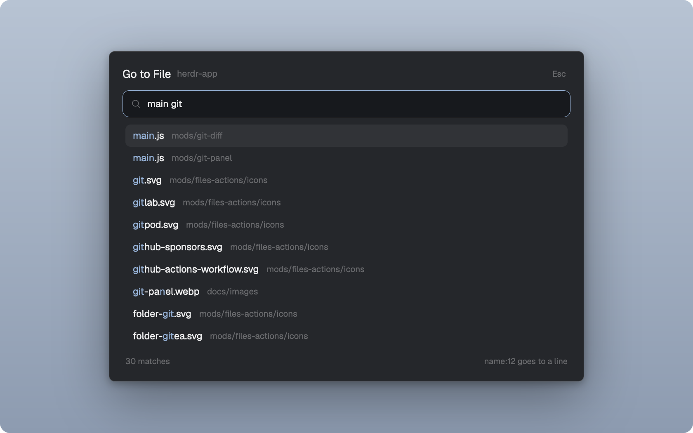

# Go to file

Go to a file of the project by typing some of its name: what Cmd+P is in VS Code. Here it is Cmd+O, since Cmd+P is Herdr's own "Go to…" for tabs. The listing is [ripgrep](https://github.com/BurntSushi/ripgrep)'s, which must be installed.

*Go to file, with two words typed. The names in the pictures are made up.*

- **Open:** Cmd+O, from a terminal or the editor. Cmd+O again or Escape closes it.
- **The project:** the repository the focused pane is in, else its folder: the same files the [search panel](project-search.md) searches. Dotfiles are listed; what git ignores is not.
- **Type:** words in any order, each anywhere in the path. A word counts most in the file's name in one piece, then in its folders, then as letters in order: `gp main` finds `git-graph/main.js`. A word with a `/` is looked for in the whole path. The letters that matched in the name are marked.
- **Go to a line:** end with `:12`, or `:12:5` for a column. `:12` alone is a line of the file the editor shows.
- **Open a file:** Up and Down move, Enter opens the file in the [editor](file-editor.md), or click it. The tab gets an editor pane when it has none.
- **Lately:** with nothing typed the files opened from here come first, newest first, so Cmd+O and Enter goes back to the file before. Among equal results a file opened lately wins.

The files are listed when the popup opens: a file made while it is open is not there until the next time. At most 20,000 files are listed. In a bigger project the popup asks the project's machine for the files that match, a moment after you stop typing.

The keys are in `keys.json`: Cmd+O under `global`, and Up and Down under `mod:go-to-file > Input`. "Go to File…" is also in the command palette.

---

[Back to the README](../README.md)
