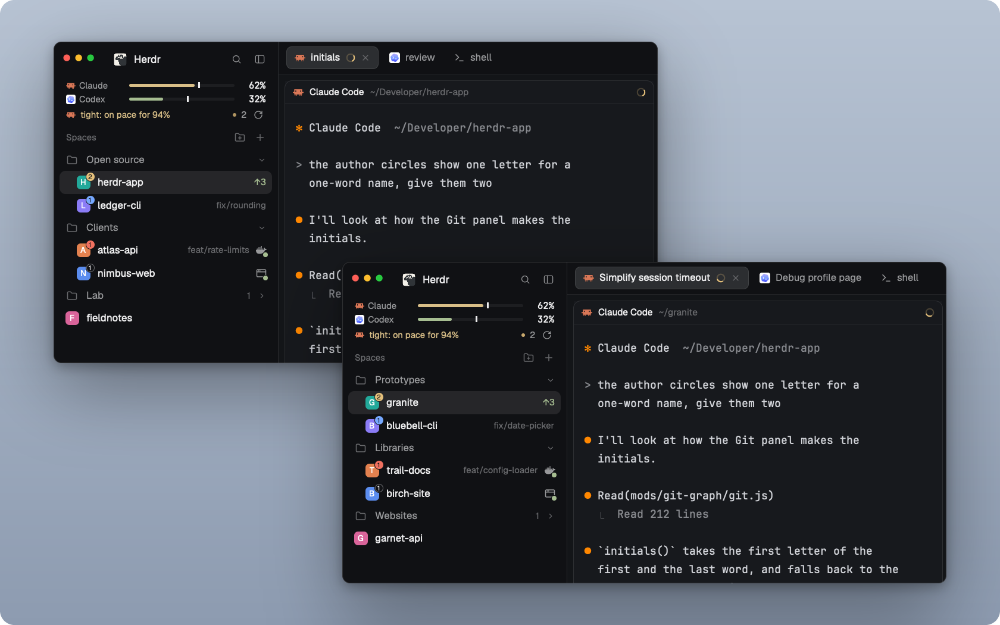

# Hide names

For a screenshot or a screen share: Cmd+Shift+H (or "Hide Names / Show Names" in the command palette) gives every space, folder, tab, branch and machine around the content a plausible made-up name, in the sidebar, the agents list, the tab bar, the pane headers, the status bar and the Usage dialog. The same real name always gets the same made-up one. What the panes and the right panel show stays real: that is the content you chose to show. Press it again to show the names; the app also shows them again when it starts.

*The same window, with names shown and hidden. The names in the pictures are made up.*

What stays as it is:

- The content: terminals, the editor, the diff, and the right panel (Files, Git, Search).
- This computer, `~`, a tab's number and a program's name.
- `main`, `master`, `develop`, `dev`, `staging`, `production`, `trunk`, `HEAD` and a branch's prefix (`feat/`, `fix/`, …).
- What is Herdr's own: its notifications, menus and dialogs, and the window's title where the system shows it.

Only what is drawn changes: a rename dialog still holds the real name, and copying a machine's login command copies the real one.

The key is in `keys.json` under `global`: `cmd-shift-h` runs `status-names.toggle`. The Usage dialog's Hide names button and its `h` key switch the same mode.

---

[Back to the README](../README.md)
