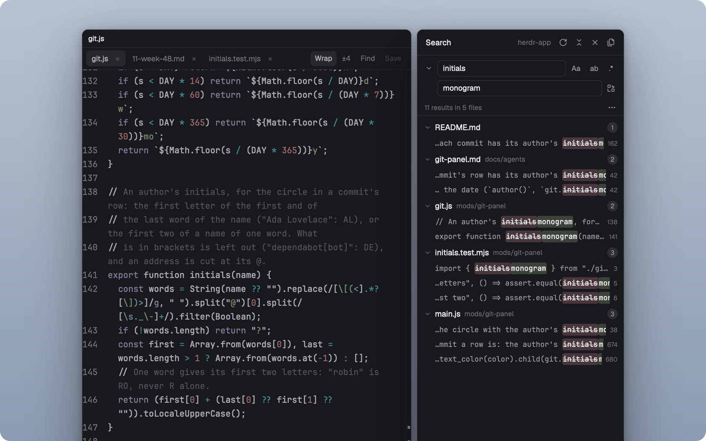

# Project Search

Search and replace across the project in the sidebar. Cmd+Shift+F switches between Project Search and Files. Esc gives the keyboard back to the editor or terminal without switching the sidebar. Search uses [ripgrep](https://github.com/BurntSushi/ripgrep), which must be installed (`brew install ripgrep`).

*A search with the replace row open: every match shows what it becomes. The names in the pictures are made up.*

- **Open:** the Search button in the Power Tools tab bar, Cmd+Shift+F, or the lens in the Files panel's header. From the editor, text selected on one line becomes the query. The Files button in the panel's header goes back.
- **The project.** Search follows the active tab's terminal to its repository or folder. When the editor has focus, Search uses the tab's last focused terminal, or its first terminal if Search has just opened. In a repository, Search runs as you type. In an ordinary folder, press Enter.
- **Options:** match case (`Aa`), whole words (`ab`) and regular expression (`.*`). The syntax is ripgrep's: no lookaround, no backreferences.
- **Filters:** the `…` button opens "files to include" and "files to exclude", comma-separated: `src`, `*.ts`, `docs/**` count at any depth, and `./src` is the folder at the project's top. Dotfiles are searched; what git ignores is not, unless "Search ignored files too" is ticked. Closed, the filters don't count.
- **Find in Folder:** right-click a folder in the Files panel to search only there.
- **Results:** grouped by file, foldable. Click a match to open the file in the [editor](file-editor.md) with the match selected. F4 and Shift+F4 go to the next and the previous result from anywhere. The list shows more as you scroll to its end, or with "Show more". At most 2,000 matches are listed, and 500 matched lines of one file: the panel says when there are more.
- **Keyboard:** Down from a field goes to the list, where Up and Down move, Enter opens, Left and Right fold, and Cmd+Backspace dismisses. Tab goes through the fields, Alt+Up and Alt+Down bring back earlier queries, and Escape gives the keyboard back to the pane or the terminal.
- **Right-click a result.** Open it in the editor, copy its path, its path in the project or its line, replace it, or dismiss it. Local results can open in an [external app](external-apps.md) or be shown in the desktop’s file manager. An external app with line arguments opens at the match.
- **To a terminal:** drag a result onto a terminal to paste its file's path there.
- **Replace:** the chevron left of the query opens the replace row, and every match shows what it becomes. With a regular expression `$1` is the first group; in plain text a `$` is a dollar. Replace one match or one file from its row, or all of them with the button beside the field, which asks first. Only the matches listed are replaced.
- **What a replace writes:** the files themselves, at once. A file that changed since the search is left alone, whole, and so is one that is not UTF-8 text or is larger than 1 MB. A file open in the editor shows its new text, or asks when it has unsaved text.
- **Undo:** **Undo replace** takes back the most recent replacement in the displayed project on its machine. It restores each file that still contains the replacement. The panel holds 24 million UTF-16 units of original and replaced text across projects. Older undo records expire as space is needed. A replacement larger than the budget has no undo record.

The search reads the files on disk: unsaved text in the editor is not searched. Results come when the search is done, not one by one.

A project on another machine is searched and edited there. The machine running the search needs ripgrep and the Unix shell tools used by the search command. Desktop actions apply to local results.

The keys are in `keys.json`. Cmd+Shift+F, F4 and Shift+F4 are under `global`. Cmd+Shift+F is also in both editor sections and the Project Search text-field section so it still works when a native text field has focus. `project-search.undo` can also be bound. “Search in Project” in the command palette always opens or focuses Search.

---

[Back to the README](../README.md)
