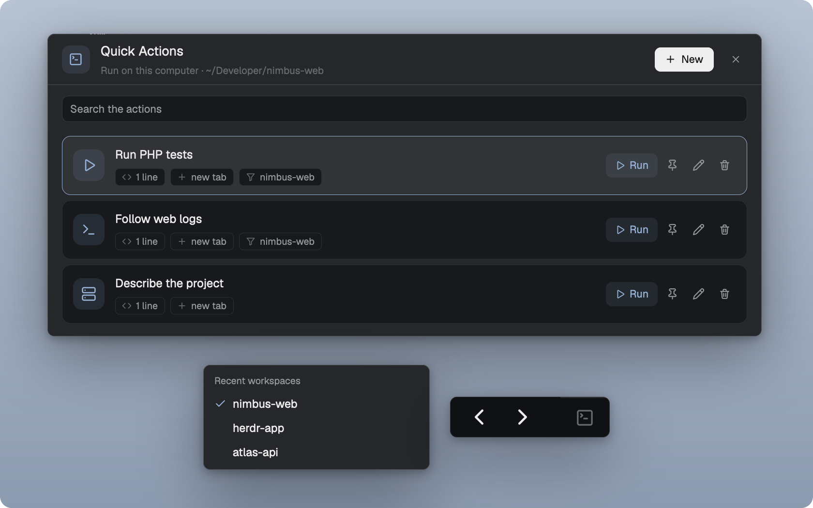

# Quick Actions

Press **Alt+Q** or click the terminal icon in the status bar to open the saved commands for your projects. The header identifies the checkout and machine. Select an action and press Enter or click **Run**. A foreground action opens a named terminal tab in the space and folder where you opened the picker. The output stays there after it finishes.

## A DDEV example

1. Open a terminal in a DDEV project and press **Alt+Q**.
2. Click **New action**. Enter **DDEV project details** for the name and `ddev describe` for the script.
3. Choose **New tab**. To limit the action to this project, enter its repository folder name in **Only in**. Save it, then select **Run**.

In the empty list, **Add 2 examples** saves two built-in presets locally: `git status --short --branch` and `ddev describe`. Choose **Run** to execute one.

Use the same pattern for an existing project test, lint or build command. A project whose tests run in DDEV can save the exact command it uses. **Favorite** puts a frequently used action first.

## Commands and context

- **Script** accepts inline text or a script file on this computer. On another machine, Herdr copies the expanded script there for that run. Auto uses the script file's extension, or `sh` on Unix and PowerShell on Windows for inline text.
- **Only in** accepts repository folder names, folder paths and wildcard patterns. The run checks this filter again on the target machine.
- A variable such as `{folder}`, `{repo}` or `{branch}` becomes one quoted value in the script's language. Write `cd {repo}` so a path containing spaces remains one argument. `{ask:Label=default}` prompts for a value before running.
- **Background** starts a separate core terminal and shows its output and stop control in the picker. The default timeout is 30 minutes. Use a foreground tab for commands that read input.
- In the edit form, **Key** gives the action's command for a custom global binding. The status bar item receives those commands.
- **Write with an agent** is optional. It starts the selected agent locally to create or change the script file. Review the result in the form before running it.

Presets are private to this Herdr home in `data/quick-actions.json`. Expanded scripts and run output live under `data/quick-actions/`. Existing foreground presets from upstream use a new tab in this setup. Reopen the picker if its original terminal closes, moves or changes directory.

Adapted from [PowerMods Quick Actions](https://github.com/dougcunha/herdr-mods/tree/93c58b5a7d0b3ab7564c45e9ecad68cc1e10cc7c/quick-actions-app).
