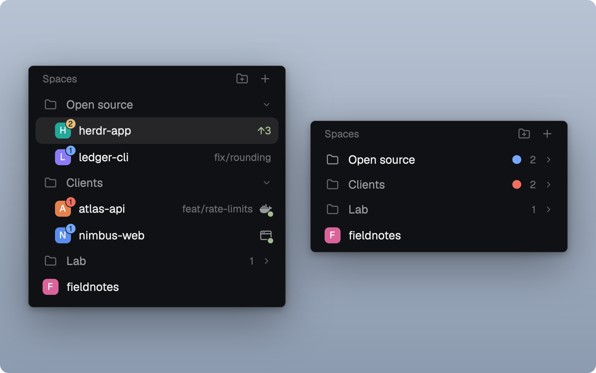

# Space Folders

Groups spaces into named folders in the sidebar. Folders are one level deep, and a space doesn't need one: it can stay at the root.

*The sidebar: folders of spaces, with each space's branch, containers and agents, and the same folders folded to their counts. The names in the pictures are made up.*

Each machine has folders of its own, drawn under its header, and a folder holds only that machine's spaces.

- **Add a folder:** the folder button next to `+` in the Spaces header, or right-click the header or the empty area under the list: the folder goes on the machine of the space shown. Right-click a machine's header for a folder on that machine.
- **Move a space:** drag it onto a folder to put it in, onto a row to place it before or after that row, or under the list to take it out of every folder. Or right-click it: Move to, Out of folder, New folder.
- **Move a folder:** drag its header.
- **New space in a folder:** the `+` on a folder's header, shown while the pointer is on it, makes a space in that machine's home folder and files it there. The folder menu’s **New space here** uses the same action. Both file the specific space they create.
- **Rename or remove a folder:** right-click it. Removing a folder leaves its spaces at the root. Nothing is closed.
- **Fold:** click the header. A folded folder shows how many spaces it holds, and a dot when one of them needs you.

A space's row also says what runs in it:

- **Agents:** a number on the space's avatar counts its agents, in the color of the most urgent one (a ring when all are idle). An idle agent [marked unread](unread-agents.md) counts as done.
- **Containers.** The DDEV projects and Docker Compose stacks of the space’s project show as buttons at the row’s end, with a site icon for DDEV and a whale for Docker. A green dot means everything is running and amber means part is running. Click a button to start or stop its stacks, or use the space menu for one stack at a time. **Open site** opens a running local DDEV site in the desktop’s default browser. A Compose-based dev container has its own button. Existing containers start with `start`, a stack that has never been started uses `up -d`, and stopping uses `stop`. Discovery uses `sh`, `find` and Unix-style paths, which limits native Windows support.

Placement survives restarts. It is also remembered by project (the repo, else the folder), so the next space opened on a filed project lands in the same folder.

The real order of spaces follows the sidebar, so `space.next`, `space.prev` and `space.select:N` match what is drawn.

A local space’s menu can open its project folder in an [external app](external-apps.md). It uses the repository’s top folder when the space is in a repository, and the space’s folder otherwise.

Three commands can be bound in `keys.json`: `space-folders.new-folder`, `space-folders.fold-all` and `space-folders.unfold-all`. They are also in the command palette (Cmd+Shift+P).

---

[Back to the README](../README.md)
