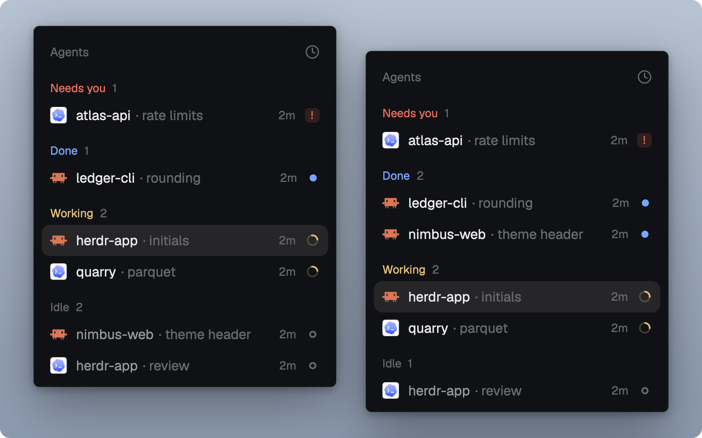

# Mark Agents Unread

Marks an idle agent as unread: it goes back under Done, with the done dot, as a reminder to look at it later.

*The Agents list before and after: the idle agent marked unread goes under Done. The names in the pictures are made up.*

- **Mark as unread:** click the empty ring at the end of an idle agent's row, or right-click the row.
- **Mark as read:** click the same spot again, or right-click the row. It also happens by itself: when you open the agent again after having been somewhere else, and when the agent starts working.

- **Pin and close:** a row shows a pin button while the pointer is on it, and for an idle agent not marked unread a close button beside it, which closes the agent's pane and ends its terminal. Both are in the right-click menu too.

Marking the agent you are looking at keeps it marked until you leave and come back. The mark lives in the list only: the tab bar and the spaces sidebar still show the agent as idle.

One command can be bound in `keys.json`: `mark-agents-unread.toggle` marks the agent you are looking at, or clears its mark. It is also in the command palette.

**Jump to an agent:** Cmd+Alt+1 to Cmd+Alt+9 go to the first to ninth agent, in the order the list draws them.

---

[Back to the README](../README.md)
