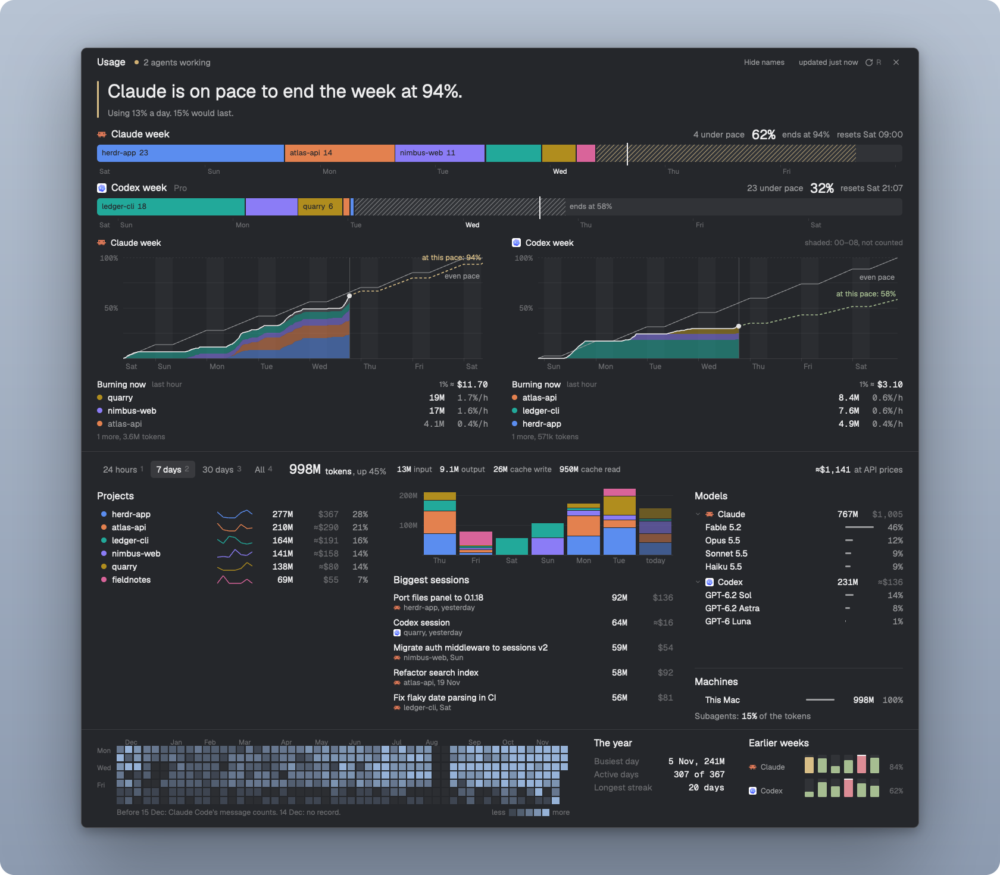

# Agent Usage

How much of the AI agents' limits is used, whether each will last the week, and where the usage went: for Claude Code and Codex, on this Mac and every connected machine. Cmd+Shift+U opens it (or "Usage" in the command palette), and a widget above Spaces shows the same readings at a glance.

*The Usage dialog. Every project, session and figure in the picture is made up.*

Tokens are the unit everywhere: input, output, cache write and cache read together. Dollars are a side figure: Claude Code's own cost for Claude, and an estimate from OpenAI's API prices for Codex, marked with "≈".

## Will it last

- **The verdict:** one sentence for the weekly limit most in danger, and how much a day would last. It gives one run-out time, rounded to the half hour, and the rulers, the charts and the sidebar say the same.
- **A ruler for each limit:** the weekly limits (Claude, then Codex), then shorter windows such as five hours when there is a reading. Its length is the limit: the colored segments are what each project used, the hatch is what this pace will still burn, the line is where an even pace would be now, and the ticks are the midnights (the hours, in a short window).
- **The weekly charts:** one for each agent with a reading, side by side from 900 px of width and taking turns below it. The used line passes through the readings on record; beside it are the even pace and where this pace ends. Nights from midnight to 08:00 are shaded and not counted as usable time.
- **Burning now:** under each chart, the projects that used that agent in the last hour, with their tokens and their share of the limit an hour, sessions outside Herdr included. Its heading says what 1% of that week costs.

## Where it went

- **Range:** 24 hours, 7 days, 30 days or everything on record (`1` to `4`), with the range's tokens, their split, the dollars, and the change against the period before.
- **Projects:** tokens, cost and share, with a sparkline. Click a row to filter the page to that project; click the name of a project that is open to go to its space. A project keeps one color on the whole page.
- **Bars and biggest sessions:** the range by day (or hour, or week), stacked by project, and the sessions at or over the range's average.
- **Models and machines:** tokens and cost by model, in a group for each agent that folds, and by machine. A machine's dev containers are listed under it.

## The year

A calendar of the last twelve months, the busiest day, the active days and the longest streak, and how the earlier weeks ended for each agent: green, amber from 85%, red at 100%.

## The sidebar widget

Above Spaces, the widget shows the limit closest to running out for each agent, its even pace and a short verdict. Click the readings to open the dialog. The widget updates whenever the dialog finishes collecting. It also checks Claude's limits every minute and Codex's every five while Herdr is active. Click the refresh icon at the right end of the third line to check both immediately.

## Keys

`1` to `4` choose the range, `r` reads again, `h` [hides names](hide-names.md), and Escape clears the project filter, then closes. `cmd-shift-u` is in `keys.json` under `global` (`mod.open:agent-usage`). More commands can be bound: `agent-usage.refresh`, `agent-usage.day`, `agent-usage.week`, `agent-usage.month`, `agent-usage.all`, `agent-usage.names`, `agent-usage.claude` and `agent-usage.codex`.

## Where the figures come from

It only reads, and it asks the network nothing.

- **Usage:** Claude Code's transcripts and cost records (`~/.claude/projects`) and Codex's sessions (`~/.codex/sessions`), read by one Node script, `packages/agent-usage/mods/agent-usage/collect.mjs`. It needs `node` 18 or later, and uses ripgrep when there is one.
- **Limits:** Codex's come from its own session files. Claude's come from the file my statusline writes, `~/.claude/statusline/.usage-cache.json`: without one there is no Claude limit, and the usage still shows.
- **Other machines:** the same script runs there through Herdr, with nothing installed. A machine that fails, or has no `node`, is shown as unreachable.
- **Dev containers:** read through `docker`, and counted as their project's.
- **History:** Claude Code keeps its transcripts for 30 days, so the day totals are kept in `~/.local/state/herdr-usage/` on each machine, with each weekly window's readings.
- **Codex prices:** the table `CODEX_PRICES` in `collect.mjs`, with the day it was fetched. A model not in it shows "no price".

The dialog reads again every 5 minutes while it is open and Herdr is the active app, every 2 while an agent works.

---

[Back to the README](../README.md)
