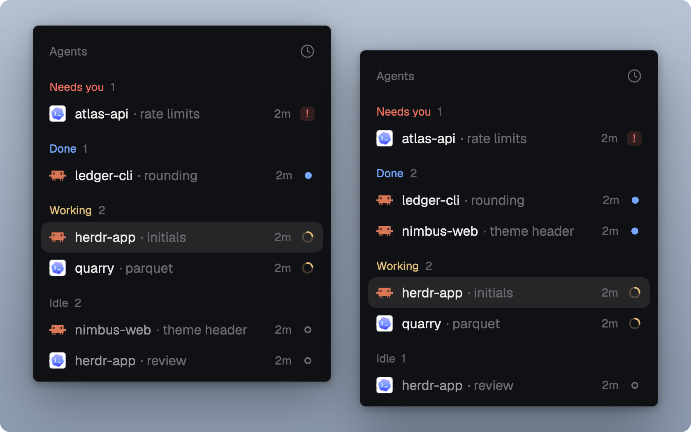

# Agent Inbox

Mark an idle agent unread when you want to return to its answer later. It moves to Done in the agents list, where it stays until you revisit it or it starts working again.

## What you see

Keep the familiar Agents sidebar and its priority groups for agents that need attention, are done, are working or are idle. At the end of an idle row, use the existing status-dot space for a clickable ring. An unread agent takes the Done color. On hover, show Pin and, for an unmarked idle agent, Close.

## How it behaves

Click the ring or right-click a row to mark it unread or read. Marking the currently focused agent leaves it marked until the user visits another pane and returns. New work clears the mark. Cmd+Alt+1 through 9 select the corresponding visible agents in list order. Keep Herdr's space grouping, priority sorting, pinning and sub-agent navigation.

## Built from

Install `mods/agent-inbox/`, merge the package keys, and point the personal layout's existing `agents` block at `agent-inbox`. Read `agents()` and `focused()`, keep marks by terminal address in shared `agents.unread`, and publish the drawn order with `setAgentOrder()`. Reopen the mod with menu props for its row menu. The palette command `agent-inbox.toggle` acts on the focused agent.

## Watch out

Keep unread as a presentation state. Preserve the core's status and notifications. A popup temporarily taking focus does not count as visiting another pane. Allow ten seconds of readable layout on a reconnecting machine before dropping a missing agent's mark. Closing an idle agent ends its terminal.

## Done when

Mark the agent you are viewing, open another pane, and return. It stays in Done after the first click and returns to Idle on the visit back. The numbered shortcuts follow the order shown after marking or pinning a row.
