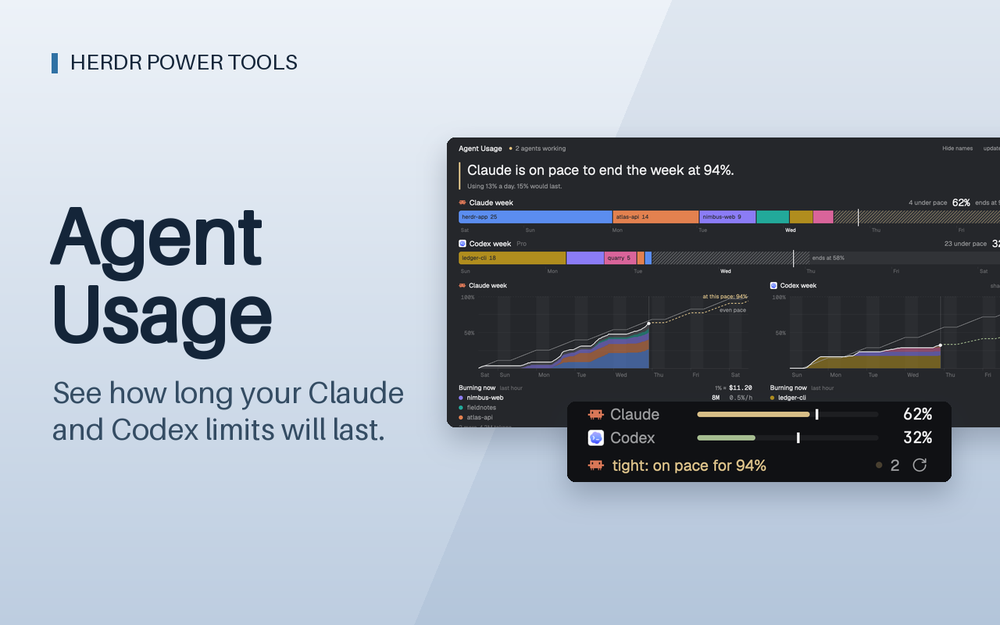

# Agent Usage

See whether Claude Code and Codex will make it to their next reset. The sidebar shows their weekly limits at a glance. The larger view shows which projects spent the tokens and which are spending them now.

## What you see

Put a 62 px widget above Spaces. In the dialog, lead with a sentence about the weekly limit most at risk. Give each limit a ruler with colored project segments, a pace marker and a hatched projection. Place the Claude and Codex weekly charts side by side from 900 px and switch between them below that width. Follow them with project, session, model and machine breakdowns and a year of daily cells.

## How it behaves

Click the widget's readings or press Cmd+Shift+U to open the dialog. Click the widget's refresh icon to check both agents immediately. Keys 1 through 4 select the last day, week, month or all history. Click a project to filter, press R to refresh and H to disguise names. Escape clears the filter before closing. Refresh the open dialog every five minutes while Herdr is active, or every two minutes while an agent works. Apply each completed collection to the widget immediately.

## Built from

Install `mods/agent-usage/` and merge the package keys. Put `{"mod":"agent-usage","props":{"role":"side"}}` in the sidebar block. The dialog also opens from the palette. Run the Node 18+ collector through Herdr on each machine. Read Claude transcripts and costs, Codex sessions and the optional Claude statusline usage cache. Count dev containers under their projects via Docker. Keep daily totals and weekly readings in `~/.local/state/herdr-usage/` on each machine.

## Watch out

The small widget reads limit figures directly. Keep the full collector out of its refresh loop. Keep readings monotonic within one reset window. Claude's limit needs a compatible statusline cache. Its token history works independently. Mark estimated Codex costs with ≈ and leave unknown prices unpriced.

## Done when

Opening the widget shows the same run-out time as the sidebar. Selecting a project changes the totals and breakdowns. A machine without Node can be unavailable while readings from the other machines stay visible.
