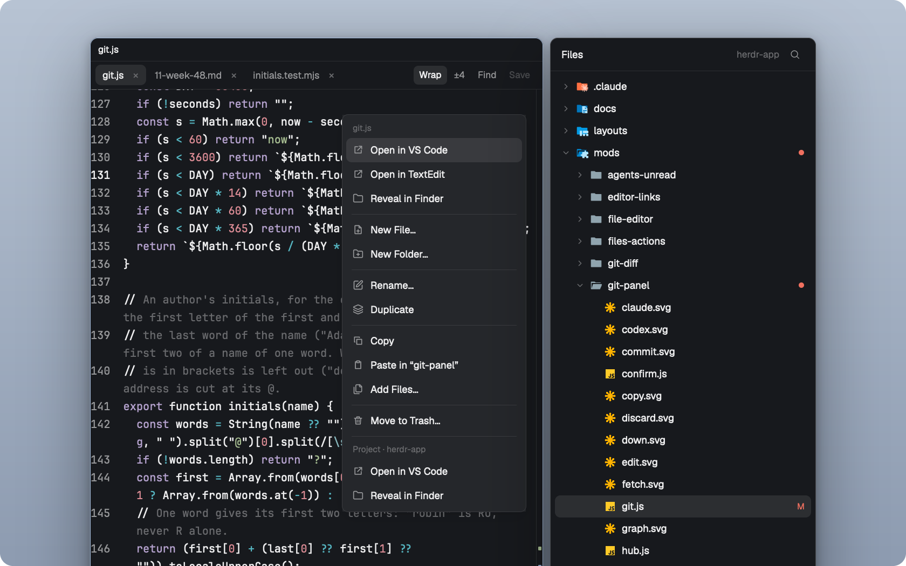

# File Actions

Manage project files from Herdr's Files panel. Drag a file to move it, drop it on a terminal to paste its path, or use the right-click menu to create, rename, duplicate and trash files.

## What you see

Use the Files tree in the side panel. Give files and folders Material Icon Theme icons, fade ignored entries and mark folders containing Git changes. Highlight the file shown in the tab's editor or its enclosing collapsed folder. Right-clicking blank space targets the project folder.

## How it behaves

Click a folder to fold it, or a file to open it in **File Editor**. A tree drop moves the entry, a terminal drop pastes the quoted path and a Finder drop copies in the files. Offer New File, New Folder, Rename and Duplicate on local and remote projects. Offer Finder, apps, the clipboard and Trash for local Mac files. Cmd+Z reverses the last move, rename or Trash for five minutes in the same folder.

## Built from

Install `mods/files-actions/` and merge its undo shortcut. Set the personal layout's existing `files` block to `files-actions`. Install **File Editor** for opening files and **Project Search** for the lens and Find in Folder. Use Herdr file watches, `exec` on the target machine, and Git for change marks. The bundled SVGs and their license are inside the mod. Route changes requested by short-lived menus through the visible panel.

## Watch out

Refuse a destination that already exists. Ask before moving an item to Trash. A release outside the tree ends a drag. Handle a Finder drop before the corresponding mouse release so it cannot trigger an earlier move. The global Cmd+Z binding also takes that shortcut while the terminal has focus.

## Done when

Drag a file into another folder and undo it. A duplicate gets an unused copy name. Dropping a path onto a terminal leaves the file where it was. An externally edited file updates its tree markers when Herdr becomes active again.
