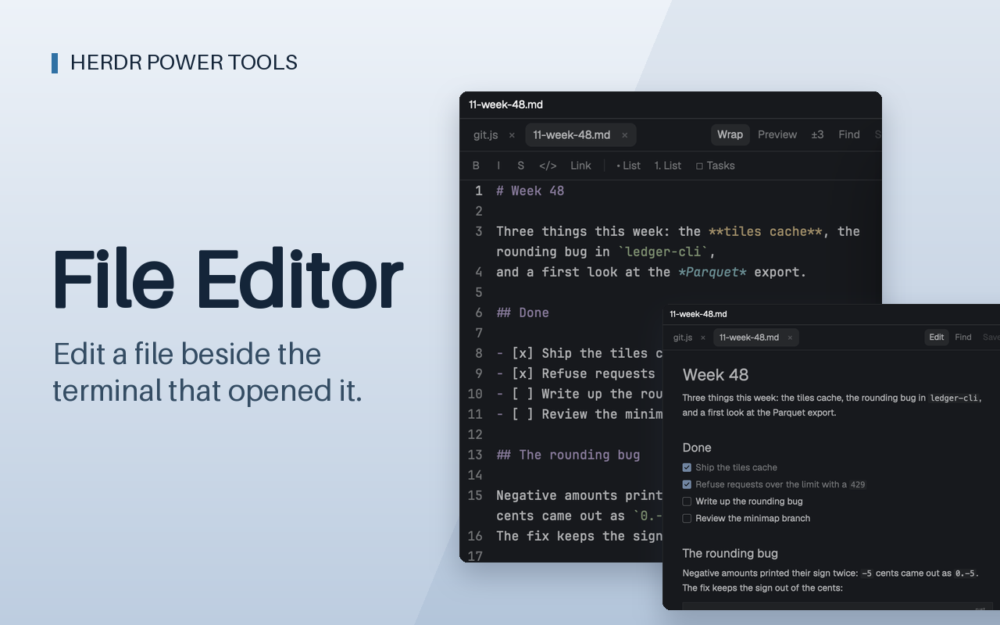

# File Editor

Cmd-click a source path printed by an agent and edit the file beside its terminal. Open another path in the same tab to add it to the editor's file strip. Markdown has a formatting toolbar. Preview Markdown, images, PDF, CSV, SVG and HTML in the pane.

## What you see

Use a split pane with tabs across the top, a dot beside unsaved files, a find bar when requested, and text at the terminal's font size. A thin strip at the right maps additions, deletions and edits since the last commit. The pane header follows the selected filename unless the user has named the pane. The footer shows disk size, live text counts and line endings, PDF page count, CSV dimensions, and image dimensions where available.

## How it behaves

Cmd+S saves. Cmd+F finds, Cmd+Alt+F replaces, and Cmd+Shift+V or Ctrl+Shift+V toggles source and preview for Markdown, CSV, SVG and HTML. Cmd-click a web URL in source or CSV (Ctrl-click on Linux or Windows), or click a link in Markdown preview. HTML and SVG snapshots surface clickable source links in a separate bar. Fit an image's first frame to the pane and show Retry if decoding or staging fails. Show PDF with page navigation, CSV as a paged table, SVG in full color and HTML as a static snapshot with a separate browser button. Drag a CSV column edge to resize and double-click a cell to edit. Applying a cell updates only that field in the draft. Support multiple cursors, per-file wrap, indentation inferred from the file, and line and Markdown commands from the package keys. Preserve unsaved drafts when a pane closes. If the file changes outside the editor, refresh clean text and ask how to reconcile dirty text.

Ctrl+W closes just the active file tab when the editor has focus. Give each file tab a right-click menu with Close, Pin or Unpin, Close Others, Close to the Right, and Close All. Keep pinned tabs at the left with a pin icon and preserve their state across reopen. Bulk closes skip pins, close clean files first, and offer Save, Discard or Cancel for each remaining unsaved file. Close Others and Close to the Right use the clicked tab.

## Built from

Install both `mods/file-editor/` and `mods/editor-links/` and merge the editor key sections. Include `editor-links` in the personal layout's root `link_handlers`. The link handler accepts regular text files, supported images and PDFs, sends `file-editor.open` with the tab and optional selection, and opens or focuses one editor pane per tab. Use Herdr's native editor and Markdown views. Keep drafts and their last-read text in per-tab local storage. Remote saves use a shell on the file's machine. Stage remote media via `hc exec` and render it locally. Use Poppler for PDF, `sips` on macOS or ImageMagick on Linux for image metadata, and Python 3.9+ with a headless Chromium browser for HTML snapshots. Make the browser action serve saved HTML and project assets on an expiring loopback address.

## Watch out

Treat truncated content as read-only. Compare the last-read text before saving and preserve remote file permissions. Forward unsupported binaries and folders to the next link handler. Herdr recognizes terminal paths containing a slash. Preserve Git change marks for staged files and compute marks outside the draw loop.

## Done when

Cmd-click a source path ending in a line and column, edit a line, then close and reopen the pane. The draft returns. An intervening disk edit prompts on save. Opening a second path reuses the pane, and a Markdown selection in preview can be located back in the source.

Pin one of several open files. Close All leaves the pinned tab and asks about unsaved files. Close to the Right leaves the clicked tab and tabs to its left open.

Open an image, a two-page PDF, a quoted CSV, an SVG and an HTML file from a local project and a paired core. Verify file details and page controls, and that the HTML snapshot shows linked styles and images while the browser can run the saved page.
