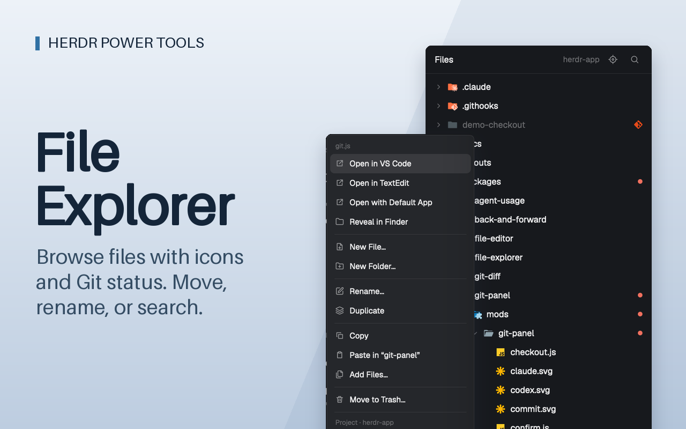

# File Explorer

Browse project files with file-type icons and Git change indicators. Open a file in the editor, start a project search, or manage files with drag and drop and the right-click menu.

## What you see

Use the Files tree in the side panel. Give files and folders Material Icon Theme icons, fade ignored entries and mark folders containing Git changes. Highlight the file shown in the tab's editor or its enclosing collapsed folder. Right-clicking blank space targets the project folder.

Fade the folder name and icon when the enclosing repository ignores a nested Git checkout. Show a full-color Git badge alongside them. Use the nested checkout's Git status for its children when expanded.

## How it behaves

Click a folder to fold it, or a file to open it in **File Editor**. Arrow keys navigate the focused tree, Enter opens the selection and Escape returns to the pane. An explicit reveal expands the editor file’s ancestors, scrolls it into view and focuses its row. A tree drop moves the entry, a terminal drop pastes the quoted path and a Finder drop copies in the files. Offer New File, New Folder, Rename and Duplicate on local and remote projects. Show available external apps and the desktop file manager for local items on macOS, Linux and Windows. Offer the Finder clipboard and Trash on macOS. Cmd+Z reverses the last move, rename or Trash for five minutes in the same folder.

## Built from

Install `mods/file-explorer/` and merge its undo shortcut. Set the personal layout's existing `files` block to `file-explorer`. Install **File Editor** for opening files and **Project Search** for the lens and Find in Folder. Use Herdr file watches, `exec` on the target machine, and Git for change marks. The bundled SVGs and their license are inside the mod. Route changes requested by short-lived menus through the visible panel.

Read optional `external-apps.json` beside `keys.json`. The shared `apps` array orders presets and custom launchers. Default to available VS Code and Obsidian, plus TextEdit on macOS. Use the operating system’s default app and file manager for the standard actions. [Settings and examples](../../docs/external-apps.md)

## Watch out

Refuse a destination that already exists. Ask before moving an item to Trash. A release outside the tree ends a drag. Handle a Finder drop before the corresponding mouse release so it cannot trigger an earlier move. The global Cmd+Z binding also takes that shortcut while the terminal has focus.

## Done when

Drag a file into another folder and undo it. A duplicate gets an unused copy name. Dropping a path onto a terminal leaves the file where it was. An externally edited file updates its tree markers when Herdr becomes active again.

An ignored nested checkout shows a faded folder name and icon with a bright Git badge while folded. Expand it and check that its tracked files are at full brightness and its own ignored files are faded. Repeat with a linked worktree.
