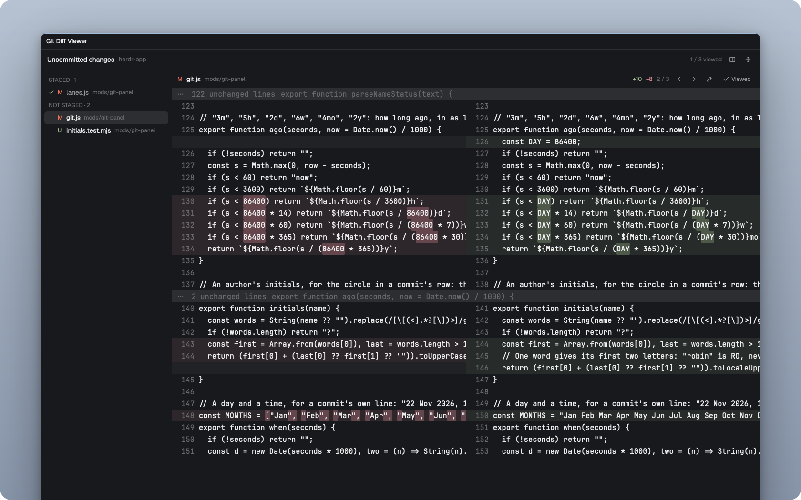

# Git Diff

Review a commit, stash or working tree beside the terminal. Mark a file viewed and move straight to the next unread change.

## What you see

Put a file list on the left and the patch on the right in the terminal's font size. Split working-tree files into staged and unstaged groups. Highlight inserted and removed lines, then color the changed words more strongly. At sufficient width use two columns if the text fits. In a narrow pane use one scrolling column with both line numbers.

## How it behaves

Click a file in **Git Graph** to open or reuse the current tab's diff pane. J and K move through files, V marks viewed, S changes columns, and W expands the unchanged lines between hunks. O opens the current file in **File Editor**. Remember review progress across restarts and clear a working-tree tick when that file changes again.

## Built from

Install `mods/git-diff/` alongside the **Git Graph** package, which opens this view. The editor shortcut also needs **File Editor**. The panel sends `git-diff.open` with the tab, repository, machine, source, path and group. Reuse a `git-diff` pane with matching tab props or split one beside the terminal. Run Git on the source machine, parse patch rows once per read and draw them in a virtual list.

## Watch out

Keep the viewer read-only. Limit the diff to 6,000 lines and bound the work spent matching words. Save the source, mode and viewed marks in local storage. Key working-tree marks to changed content so switching context display does not clear them.

## Done when

Review two files, mark one viewed, and change it again from the terminal. Its tick clears. Switching between unified and split view or revealing unchanged lines preserves ticks on the other files.
