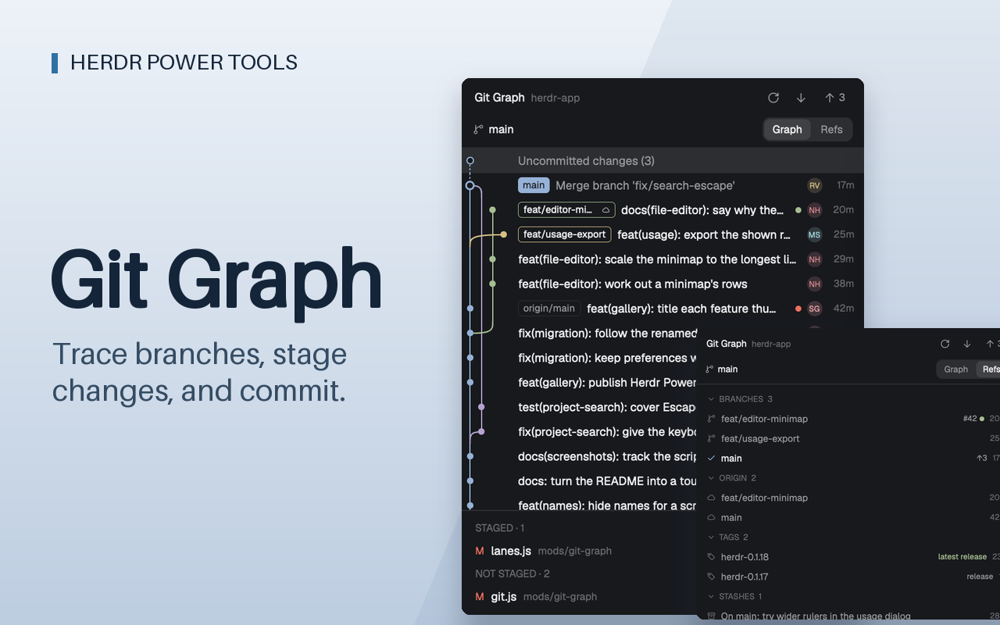

# Git Graph

Follow a repository's history across branches, then stage files, write a commit or push from the same panel. Select a commit to read its message and see exactly which files changed.

## What you see

Put the graph above a resizable detail area in the right panel. Draw branch lanes and merge curves, a ring at HEAD and a dashed line to the uncommitted row. Show staged and unstaged files separately. A second view groups branches, remotes, tags and stashes. Show ahead and behind counts beside Fetch, Pull and Push.

## How it behaves

Follow the focused pane's repository, with a chooser for repositories inside it or enclosing it. Page history in groups of 1,000. Click to inspect, double-click a branch to switch, and right-click for actions on that exact reference or file. Stage with +, unstage with −, and commit with Cmd+Enter. With nothing staged, the commit includes all changes. Discard saves a recoverable stash. The message writer fills an editable field.

Open a failed commit run or PR check on request. For GitHub Actions, show the failed jobs, step names and a bounded log with Copy log. Offer the original URL when GitHub cannot supply the log or the provider hosts its own check.

Offer **Review branch…** on a branch in Refs and on the current repository. Let the reader filter local and remote base refs and open a committed branch comparison in the tab’s Git Diff pane.

## Built from

Offer **Go to Open Checkout** in the menu for a checked-out branch. Focus the terminal using that checkout, offering a choice if several spaces have one open. Check the repository and branch on the space’s machine before navigating.

Install `mods/git-graph/` and point the existing `changes` block at `git-graph` so the tab bar opens it. Install the **Git Diff** package for file diffs and **File Editor** for Open in Editor. Read and change Git through Herdr's `exec` on the project's machine. Keep graph layout separate from Git parsing. Optional `gh` reads GitHub status. On request, a local Claude or Codex CLI receives the diff, new-file excerpts and recent commit messages to draft a message.

## Watch out

Before a write, recheck HEAD and the selected reference or stash. Pull fast-forward only. Preserve staged and unstaged changes in a discarded file's stash. Treat filenames as literal Git pathspecs. Pause background reads while the panel is hidden or Herdr is inactive.

## Done when

In a scratch repository, stage one of two files and commit just that file. Click the commit to review it. Discard a change and recover it from its stash. If another terminal moves a selected reference before an action runs, the panel reports the change and asks the user to start again.
