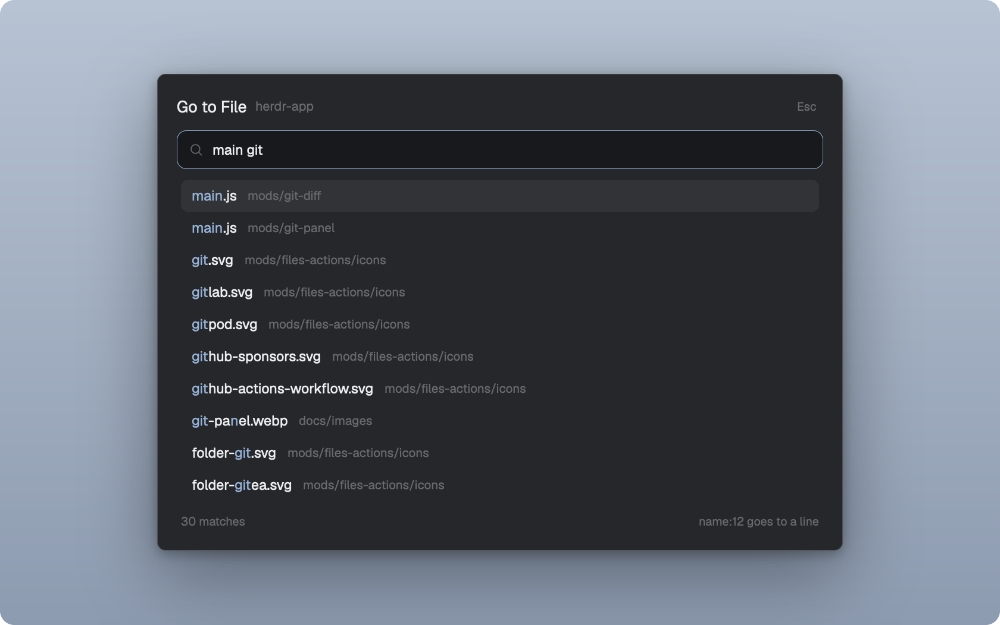

# Go to File

Open a project file by typing a few letters of its name. Append a line and column to jump directly to a location in the editor.

## What you see

Open a 640 px wide popup at the top of the window with a query field, a ranked list of filenames, their folders and a status line. Emphasize matching letters. With an empty query, put recently opened files first.

## How it behaves

Cmd+O toggles the popup. Words can occur in any order. Prefer a whole word in the filename, then folders, then matching letters in order. Up and Down select a result, Enter or a click opens it and Escape closes. Accept a trailing `:12` or `:12:5`. A line number alone targets the file already shown in the editor.

## Built from

Install `mods/go-to-file/`, merge the package shortcuts and install **File Editor**. No layout block is required. Call `rg --files` on the project's machine, using the focused pane's repository or folder. Keep recent paths in shared `go-to-file.recent`, keyed by machine and root. Open the result through `file-editor.open` and reuse the editor in that tab.

## Watch out

Include dotfiles and honor Git ignore rules. Refresh the inventory when the popup opens. Above 20,000 paths, send the typed query back to the project's machine after a short pause. A slower answer for an older query must never replace the latest result list.

## Done when

Find a nested file with two abbreviated words, open a specific line and column, then reopen the popup with an empty field. The file is near the top of its project's recent list. The same sequence opens a remote file on its own machine.
