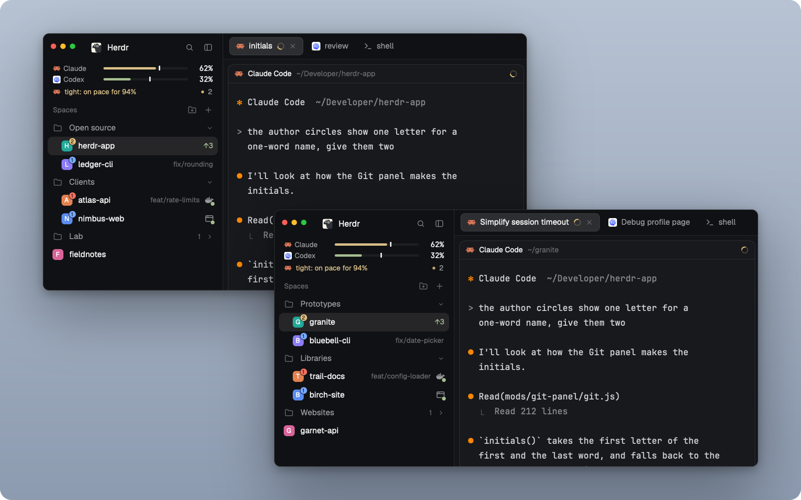

# Hide Names

Disguise the project names around a terminal during a screen share. One shortcut switches tabs, pane headers and the status bar to consistent made-up names. The terminal or document you chose to share stays readable.

## What you see

Keep Herdr's existing tab strip, pane headers and status bar in their usual positions. Substitute plausible names for named tabs, project folders, machines and topic branches. Preserve the branch prefix, numbered tabs and common names such as main. The matching sidebar and usage tools follow the same switch when installed.

## How it behaves

Cmd+Shift+H or the palette's Hide Names / Show Names toggles the window. Draw each alias consistently wherever the same kind of name appears. Switching back restores the original display immediately. A fresh app session starts with names visible again.

## Built from

Install `tabs-names`, `pane-names` and `status-names` from the package's `mods/` folder and merge its key. In a personal layout set the tab bar's mod to `tabs-names`, the active tab's pane header to `pane-names`, and the status block to `status-names`. Turn `names.hidden` on or off through the shown status mod. Each mod computes aliases from the input and its kind. **Space Folders**, **Mark Agents Unread** and **Agent Usage** also read the flag.

## Watch out

Apply aliases at draw time. Real IDs and paths still drive selection, file operations, sorting and machine commands. A terminal, document, diff, right-side panel, native menu, notification or rename field can contain real text. Include this scope in the user-facing instructions.

## Done when

Toggle the mode and follow a project across two surfaces that display it. Its aliases agree. Navigation and file operations reach the same targets in both modes. The next fresh launch shows the actual names.
