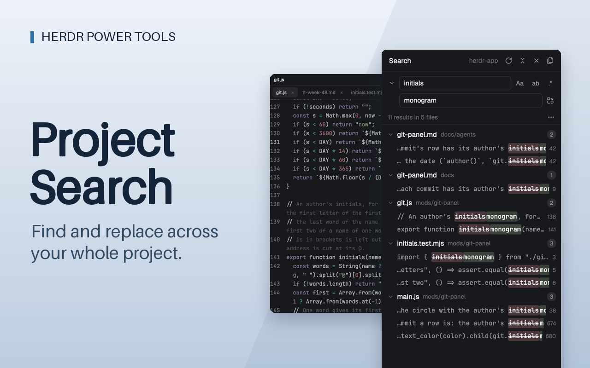

# Project Search

Find text across a project and preview each replacement before writing it. Matches appear under their filenames in a panel beside the terminal.

## What you see

Place the query and its case, word and regex toggles above a foldable result list. A chevron reveals the replacement field. An ellipsis reveals include and exclude globs and the option to search ignored files. Each result has a line number and a highlighted match. Show the replacement beside it when the replace row is open.

## How it behaves

Cmd+Shift+F toggles between Search and Files, including when the query field has focus. On opening Search it uses a one-line selection from the editor when available. Esc gives focus back to the pane without switching the sidebar. Search as the user types in a repository, or on Enter outside one. F4 and Shift+F4 open the next and previous matches. Replace a match, a file, or all listed results with confirmation for Replace All. Undo the last replace in files that still match the written version.

Resolve the project from the active tab's focused or last focused terminal. When Search first opens with the editor focused, use the first terminal in that tab. Wait for the current project before applying a search request.

For a local result, offer the available external apps, the default app and the desktop file manager. Open at the match when the launcher accepts line and column arguments.

## Built from

Install `mods/project-search/`, the package keys, and **File Editor** to open a match. Run ripgrep on the machine holding the project. In a personal layout put one copy in the Files/Changes stack as child `search`, with `back: {stack: "panel-body", child: "files"}` in its props. Put a second, always-present copy in a zero-height block with props `{keys: true, show: {panel: "panel", stack: "panel-body", child: "search"}}`. Substitute the actual block IDs if yours differ.

Read optional `external-apps.json` beside `keys.json`. The shared `apps` array orders presets and custom launchers. Default to available VS Code and Obsidian, plus TextEdit on macOS. [Settings and examples](../../docs/external-apps.md)

## Watch out

Search the saved files. Limit the list to 2,000 matches and 500 matching lines per file. Bound replacements to the listed matches and skip an entire file if it changed after the search, exceeds 1 MB or is unsuitable for UTF-8 editing. A remote project needs ripgrep there. Native text fields take navigation keys, so bind the input-specific sections in the field's context.

## Done when

Open search while the side panel is hidden, find two instances, and use F4 from a terminal to reach one. Change one matched file externally before Replace All. The other file can be replaced and restored with Undo while the externally edited file keeps its text.
