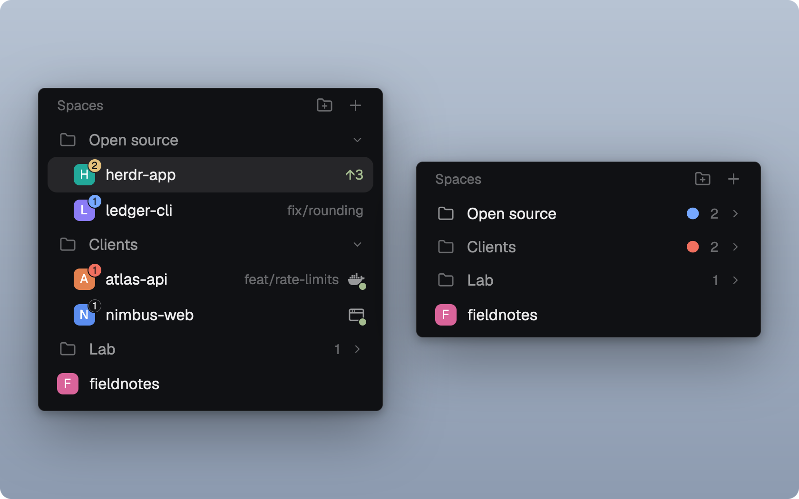

# Space Folders

Group spaces by project or client, fold a group when you are done with it, and see which agents and containers are running without opening each space.

## What you see

Give each machine its own section in the Spaces sidebar. Mix folder headers and loose spaces at its root. Indent folder members one level, and nest a worktree under its repository. A folded header shows its count and an attention dot. A badge on the space avatar counts agents in the most urgent status color. Show DDEV, Compose and dev-container controls at the end of the row.

## How it behaves

Drag spaces into, out of or between folders on their machine. Drag headers to reorder folders. Click a header to fold it or its hover + to start a space there. Folder and space menus offer the same filing actions. Removing a folder puts its spaces back at the root. A new space on an already filed project joins that folder. Click a container button to start or stop the associated stack.

## Built from

Install `mods/space-folders/`. In a personal copy of the layout set the existing `spaces` block's `content.mod` to `space-folders`. Start from Herdr's Spaces view, use `spaces()`, `machines()`, `agents()` and `space.move`, and store folder membership and project placement in shared `space.folders`. Query DDEV and Docker Compose per machine while Herdr is active. Use the bundled site and dev-container art and Herdr's Docker icon.

## Watch out

Space IDs identify membership. A temporarily unavailable machine can omit valid spaces during reconnect. Wait for a readable layout before pruning. Existing Compose containers start with `start` and stop with `stop`. Only a new stack needs `up -d`. Give a dev container a separate control from the project's stack.

## Done when

Filing a space changes the order followed by Next Space, reopening its project restores the folder, and removing that folder leaves the terminals running. Folding a folder still lets a person see that an agent inside needs attention.
